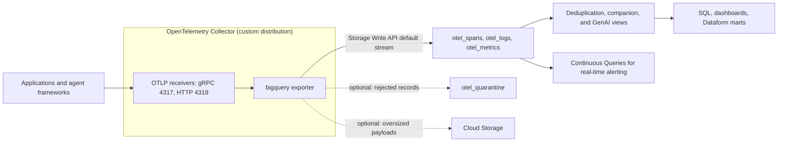

# BigQuery Exporter

<!-- status autogenerated section -->
| Status        |                                                                |
| ------------- | -------------------------------------------------------------- |
| Stability     | [development]: traces, logs, metrics                           |
| Distributions | none yet                                                         |
| Issues        | [](https://github.com/GoogleCloudPlatform/BQ-OTEL-Exporter/issues) |
| Maintainers   | [haiyuan-eng-google](https://github.com/haiyuan-eng-google), [schan1031](https://github.com/schan1031) |

[development]: https://github.com/open-telemetry/opentelemetry-collector/blob/main/docs/component-stability.md#development
<!-- end autogenerated section -->

[](https://github.com/GoogleCloudPlatform/BQ-OTEL-Exporter/actions/workflows/ci.yml)
[](https://github.com/GoogleCloudPlatform/BQ-OTEL-Exporter/actions/workflows/bench-fuzz.yml)
[](https://pkg.go.dev/github.com/GoogleCloudPlatform/BQ-OTEL-Exporter)
[](LICENSE)

Exports OTLP **traces, logs, and metrics** into documented BigQuery relational tables via
the [BigQuery Storage Write API](https://cloud.google.com/bigquery/docs/write-api).

The OpenTelemetry Collector has no BigQuery exporter. Getting traces, logs, and metrics
into BigQuery for SQL analytics today means routing through Cloud Logging sinks,
standing up Pub/Sub plus Dataflow, or batch-loading files — an extra product
hop, an extra pipeline to operate, or manual work.

This component has exactly one job: **reliable transport with a stable,
documented schema.** It is not an analytics product. It does not aggregate,
sample, downsample, or interpret telemetry.

> [!NOTE]
> This is not an officially supported Google product. This project is not eligible for the [Google Open Source Software Vulnerability Rewards Program](https://bughunters.google.com/open-source-security). See [SUPPORT.md](SUPPORT.md) for support and community channels.

## Architecture overview

The exporter runs inside a custom OpenTelemetry Collector distribution built
with the OpenTelemetry Collector Builder (see [Getting started](#getting-started)).
It receives OTLP traces, logs, and metrics, maps each record onto the
documented `v0alpha3` (`v1.0.0-candidate`) tables, and appends the rows through the Storage Write
API default stream. Deduplication and analysis views sit on top of the base
tables.



## Key capabilities and validated performance

The current release is `v0.1.0`, at development component stability.

- **Documented, versioned schema.** Traces, logs, and metrics land in
  `otel_spans`, `otel_logs`, and `otel_metrics` under the
  [`v0alpha3` contract](#schema-contract-v0alpha3), which stores plain `JSON`
  attribute bags stamped with `otel_schema_*` table labels.
- **At-least-once delivery with read-time deduplication.** Every row carries a
  deterministic identity, and the `_dedup` views collapse retried appends. See
  [Delivery semantics](#delivery-semantics).
- **Least privilege by default.** `auto_create` can create the dataset, tables,
  views, and search indexes, but it is off by default, so the exporter needs
  only metadata-read and append permissions. See [IAM](#iam).
- **Protection before export.** Optional redaction of sensitive keys and
  values, structural limits on pathological payloads, an optional dead-letter
  table for rejected records, and Cloud KMS keys and labels for the resources
  it creates. See [Redaction](#redaction) and
  [Structural limits](#structural-limits).
- **Large-payload offload and adaptive backpressure.** Optional
  content-addressed offload of oversized values to Cloud Storage, referenced
  from BigQuery as `ObjectRef` values, and optional AIMD control of request
  size and concurrency under Storage Write API congestion.

Throughput at `write.stream_pool_size=4`, with 1 KiB payloads and redaction off:

| Destination | Spans/s | Logs/s | Metric points/s |
| --- | ---: | ---: | ---: |
| In-process Storage Write API fake (`bqfake`) | 27,896 | 28,983 | 23,544 |
| Live BigQuery | 10,404 | 9,594 | 9,185 |

Against live BigQuery the exporter used 1.24–1.66 vCPU cores per 10,000
rows/s, with an 86.8 MiB process peak RSS and `companion_views` disabled during
the throughput runs. Across `write.stream_pool_size=1..16` in `bqfake`,
throughput ranged from 18,791 to 29,459 spans/s, 22,650 to 28,983 logs/s, and
15,876 to 23,544 metric points/s. Under fault injection in `bqfake`, with every
second batch throttled and acknowledgements delayed by 25 ms, every throttled
batch succeeded on retry, and payload offload reached a 99.92% SHA-256
deduplication hit rate on the benchmark's repeated 8 KiB payloads. The live
integration test suite (`-tags=integration`) exercises `auto_create` view
provisioning, timeout recovery, and the deduplication views. Methodology and
raw results are in
[`docs/benchmarks/v0.1.0-performance-envelope.md`](docs/benchmarks/v0.1.0-performance-envelope.md),
and [`docs/cost-estimation.md`](docs/cost-estimation.md) models BigQuery and
Cloud Storage cost.

## Deployment options

The stock `otelcol-contrib` image does not include this exporter, so the
Collector options below run a custom distribution. The BigQuery options
provision the destination and build on the exported tables.

| Option | Start here | Use it to |
| --- | --- | --- |
| Collector Builder | [`example/otelcol-builder.yaml`](example/otelcol-builder.yaml) and `make collector-check` | Build the distribution and check component registration and configuration parsing without credentials. |
| Docker Compose | [`example/docker-compose.yml`](example/docker-compose.yml) | Run the Collector on one host for development; see [Getting started](#getting-started). |
| Helm on Kubernetes or GKE | [`deploy/helm/bigquery-otel-collector/`](deploy/helm/bigquery-otel-collector/) | Run the Collector as a sidecar or a gateway. |
| Cloud Run | [`deploy/cloudrun/service.yaml`](deploy/cloudrun/service.yaml) | Run a serverless, autoscaling Collector. |
| Terraform | [`deploy/terraform/`](deploy/terraform/) | Provision the dataset, tables, views, Collector service account, and IAM bindings. |
| Dataform | [`deploy/dataform/`](deploy/dataform/README.md) | Build incremental marts over the companion views for the dashboards. |
| Continuous Queries | [`deploy/continuous-queries/`](deploy/continuous-queries/README.md) | Send real-time alerts on newly appended spans. |

[`deploy/README.md`](deploy/README.md) has quick starts for Helm and Cloud Run,
[`docs/deployment-models.md`](docs/deployment-models.md) compares the sidecar,
gateway, Cloud Run, and Docker Compose models,
[`dashboards/`](dashboards/README.md) has ready-made Looker Studio and Grafana
dashboards, and [`docs/operator-guides/`](docs/operator-guides/README.md) has
production runbooks for the four operator CLIs.

## Design

The reasoning behind the table layout, deduplication, rejection rules and
delivery semantics is written down in
[`docs/schema-rationale.md`](docs/schema-rationale.md). Code comments that need
that background point to the page, so the repository stands on its own.

## Getting started

The stock `otelcol-contrib` image does not contain this repository's exporter.
Build the pinned custom distribution defined in
[`example/otelcol-builder.yaml`](example/otelcol-builder.yaml) and verify both
component registration and configuration parsing without credentials:

```bash
make collector-check
```

For the Docker Compose path, choose a dataset name and an ADC file. Compose
builds the same distribution into a non-root image with
[`example/Dockerfile`](example/Dockerfile). The example opts into creating the
dataset, the active trace/log tables, and their deduplication views, so the
identity needs the creation permissions listed under [IAM](#iam).

```bash
export BQ_PROJECT=my-project
export BQ_DATASET=otel
export BQ_LOCATION=US
export BQ_ADC_PATH="$HOME/.config/gcloud/application_default_credentials.json"
# gcloud writes that file owner-only; run the container as its owner.
export BQ_CONTAINER_USER="$(id -u):$(id -g)"
docker compose -f example/docker-compose.yml up --build
```

The collector listens on OTLP/gRPC `localhost:4317` and OTLP/HTTP
`localhost:4318`. For a pre-provisioned destination, disable the two
`auto_create` flags in the example config and grant only metadata-read plus
append permissions.

The equivalent exporter fragment is:

```yaml
exporters:
  bigquery:
    project: my-project
    dataset: otel
    traces:
      table: otel_spans
    logs:
      table: otel_logs

service:
  pipelines:
    traces:
      receivers: [otlp]
      exporters: [bigquery]
    logs:
      receivers: [otlp]
      exporters: [bigquery]
```

### Transports

> **Keep both OTLP receivers enabled: gRPC on `4317` and HTTP on `4318`.** The
> sending framework chooses the transport, not the collector. Google ADK and
> LangGraph (through LangSmith) can send OTLP/HTTP on `4318` only. The other
> frameworks in the
> [compatibility matrix](docs/agent-frameworks.md#compatibility-matrix) accept
> gRPC or HTTP, and most of their setup recipes use gRPC on `4317`. Dropping the
> `4318` receiver leaves ADK and LangGraph sending nothing; dropping `4317`
> breaks those gRPC recipes. [`example/otel-collector-config.yml`](example/otel-collector-config.yml)
> enables both, and CI exercises both ports against it.

### Startup errors

None of these is the stock image's `'exporters' unknown type: "bigquery"`,
which means the binary is not this distribution. The collector prints the
exporter's startup errors after `Error: cannot start pipelines: failed to
start "bigquery" exporter:`, and credential errors after a further
`creating BigQuery metadata client: google:`. Messages use the example values
above.

| Look for | Cause and action |
| --- | --- |
| `required variable BQ_ADC_PATH is missing a value: Set BQ_ADC_PATH to an ADC JSON file` | From Compose, before any container starts. Export `BQ_ADC_PATH`. |
| `could not find default credentials` | No credentials reach the collector. Mount an ADC or service-account key file, as Compose does from `BQ_ADC_PATH`. |
| `open /creds/adc.json: permission denied` | The image's non-root user cannot read an owner-only file. Export `BQ_CONTAINER_USER` as above. |
| `missing 'type' field in credentials` | `BQ_ADC_PATH` names a file that is not a credential. |
| `destination dataset my-project.otel does not exist; create it or enable auto_create.dataset` | The dataset is absent and creation is off. |
| `destination table my-project.otel.otel_spans does not exist; create it or enable auto_create.tables` | The table is absent and creation is off. Run the DDL in [`internal/schema`](internal/schema/schema.go), or enable creation. |
| `creating destination table my-project.otel.otel_spans:` followed by the BigQuery error | Creation is on but the identity may not create the table; the dataset and `_dedup` view fail the same way. Grant the [IAM](#iam) create permission, or pre-create and turn `auto_create` off. |
| `append denied on my-project.otel.otel_spans: the writing identity needs bigquery.tables.updateData on this table (the write-only custom role, or roles/bigquery.dataEditor)` | Logged when an append is refused. The collector keeps running and does not retry that batch. Grant the write permission. |

### Credentialed smoke

CI builds the image through Compose and starts it without credentials, with
the destination pointed at a closed loopback port. It shows both OTLP ports
accepting data and every credential error above, but nothing reaches BigQuery.
Landing rows is this manual check, which has not been run yet
([#4](https://github.com/GoogleCloudPlatform/BQ-OTEL-Exporter/issues/4)). With
the collector above running, send one span and one log that share a trace ID:

```bash
TRACE_ID=$(openssl rand -hex 16)
SPAN_ID=$(openssl rand -hex 8)
NOW="$(date +%s)000000000"
curl -fsS -H 'Content-Type: application/json' --data-binary @- \
  http://localhost:4318/v1/traces <<EOF
{"resourceSpans":[{"resource":{"attributes":[{"key":"service.name","value":{"stringValue":"compose-smoke"}}]},
  "scopeSpans":[{"spans":[{"traceId":"$TRACE_ID","spanId":"$SPAN_ID","name":"compose-smoke","kind":1,
  "startTimeUnixNano":"$NOW","endTimeUnixNano":"$NOW"}]}]}]}
EOF
curl -fsS -H 'Content-Type: application/json' --data-binary @- \
  http://localhost:4318/v1/logs <<EOF
{"resourceLogs":[{"resource":{"attributes":[{"key":"service.name","value":{"stringValue":"compose-smoke"}}]},
  "scopeLogs":[{"logRecords":[{"timeUnixNano":"$NOW","traceId":"$TRACE_ID","spanId":"$SPAN_ID",
  "severityText":"INFO","body":{"stringValue":"compose-smoke"}}]}]}]}
EOF
```

After the 5 s batch interval, each deduplication view must hold exactly one
logical row for that ID:

```bash
sleep 10
bq query --project_id="$BQ_PROJECT" --nouse_legacy_sql \
  --parameter="trace_id::$TRACE_ID" --parameter="span_id::$SPAN_ID" "
SELECT 'span' AS signal, COUNT(*) AS logical_rows
FROM \`$BQ_PROJECT.$BQ_DATASET.otel_spans_dedup\`
WHERE trace_id = @trace_id AND span_id = @span_id
UNION ALL
SELECT 'log', COUNT(*)
FROM \`$BQ_PROJECT.$BQ_DATASET.otel_logs_dedup\`
WHERE trace_id = @trace_id AND span_id = @span_id"
```

The collector log should show no `append failed` line. Stop it with
`docker compose -f example/docker-compose.yml down`.

## Agent framework inputs

“Supports OTLP” is not the same as “works with environment variables only.”
The execution-verified [agent framework guide](docs/agent-frameworks.md) records
the activation tier, gRPC/HTTP support, signal placement, content defaults, and
privacy caveats for Claude Code/Agent SDK, Google ADK, LangGraph, OpenAI,
CrewAI, AWS Bedrock, and Microsoft Agent Framework.

Two collector settings are non-negotiable for that matrix: enable both OTLP
receivers because ADK and LangGraph are HTTP-only on their built-in paths, and
keep the logs pipeline because several frameworks emit model content or cost
as log events rather than span attributes.

## Configuration

See the [configuration inventory](docs/config-inventory.md) for the full option inventory and stability classification (`stable` vs. `experimental`), and the [migration guide](docs/migration.md) for deprecation rules and schema compatibility across releases.

| Option                          | Default               | Description |
| ------------------------------- | --------------------- | ----------- |
| `project`                       | *required*            | Google Cloud project owning the destination dataset (supports domain-scoped IDs such as `example.com:my-project`). |
| `dataset`                       | *required*            | Destination BigQuery dataset ID. |
| `location`                      | —                     | Dataset location. Required only when creating a dataset. |
| `kms_key_name`                  | —                     | Default Cloud KMS CryptoKey resource name (`projects/{p}/locations/{l}/keyRings/{kr}/cryptoKeys/{ck}`) applied when creating the dataset, signal tables, or quarantine table unless overridden per signal/quarantine. |
| `labels`                        | —                     | Default Google Cloud resource labels (`map[string]string`, up to 60 custom table labels — BigQuery's 64-label limit minus 4 reserved `otel_schema_*` labels) applied when creating the dataset, signal tables, quarantine table, and views. |
| `traces.table`                  | `otel_spans`          | Destination table for OTLP spans. |
| `traces.partition_granularity`  | `HOUR`                | Creation-time partitioning granularity when creating `traces.table` (`HOUR` or `DAY`). Existing tables are not repartitioned in place. |
| `traces.clustering`             | `[service_name, trace_id, name]` | Optional 1–4 clustering columns when creating `traces.table`, bounded to `otel_spans_dedup`'s `PARTITION BY` window (`service_name`, `trace_id`, `span_id`, `name`). |
| `traces.partition_expiration_days` | `0`                | Partition retention in days when creating `traces.table` (`0` omits partition expiration). |
| `traces.require_partition_filter` | `false`             | Require a partition filter on queries over `traces.table` when created. |
| `traces.kms_key_name`           | —                     | Per-table Cloud KMS CryptoKey override when creating `traces.table`. |
| `traces.labels`                 | —                     | Labels merged on top of top-level `labels` when creating `traces.table` and its deduplication/companion views. |
| `traces.max_staleness`          | —                     | BigQuery table `max_staleness` duration (`1s`..`168h`, e.g. `15m`) when creating `traces.table`. |
| `traces.search_index.columns`   | `[trace_id, span_id]` | Create-only search index columns (or `["ALL COLUMNS"]`) when `auto_create.search_indexes` is enabled. |
| `traces.search_index.analyzer`  | `NO_OP_ANALYZER`      | Create-only search index analyzer (`NO_OP_ANALYZER`, `LOG_ANALYZER`, or `PATTERN_ANALYZER`). |
| `logs.table`                    | `otel_logs`           | Destination table for OTLP log records. |
| `logs.partition_granularity`    | `DAY`                 | Creation-time partitioning granularity when creating `logs.table` (`DAY` or `HOUR`). Existing tables are not repartitioned in place. |
| `logs.clustering`               | `[service_name, trace_id, severity_number]` | Optional 1–4 clustering columns when creating `logs.table`, bounded to `otel_logs_dedup`'s `PARTITION BY` window (`service_name`, `log_name`, `severity_number`, `trace_id`, `span_id`, `insert_id`). |
| `logs.log_name_attribute`       | —                     | Optional log attribute carrying `log_name` before falling back to `gcp.log_name`, `logging.googleapis.com/logName`, `log.iostream`, `service_name`, and `"default"`. |
| `logs.insert_id_attribute`      | —                     | Optional log attribute carrying `insert_id` before falling back to `logging.googleapis.com/insertId`, `gcp.insert.id`, `gcp.insert_id`, `log.record.uid`, and (when `logs.synthesize_insert_id` is `true`) an `id1:` synthesized hash. |
| `logs.synthesize_insert_id`     | `true`                | Synthesize a compact 26-character content-hash `insert_id` (`id1:<22-char base64url>`) when no upstream insert ID attribute is present; set `false` to write `NULL` (`insert_id IS NULL`) and withdraw retry deduplication guarantees for ID-less logs. |
| `logs.partition_expiration_days` | `0`                  | Partition retention in days when creating `logs.table`. |
| `logs.require_partition_filter` | `false`               | Require a partition filter on queries over `logs.table` when created. |
| `logs.kms_key_name`             | —                     | Per-table Cloud KMS CryptoKey override when creating `logs.table`. |
| `logs.labels`                   | —                     | Labels merged on top of top-level `labels` when creating `logs.table` and its deduplication/companion views. |
| `logs.max_staleness`            | —                     | BigQuery table `max_staleness` duration (`1s`..`168h`) when creating `logs.table`. |
| `logs.search_index.columns`     | `[trace_id, span_id]` | Create-only search index columns (or `["ALL COLUMNS"]`) when `auto_create.search_indexes` is enabled. |
| `logs.search_index.analyzer`    | `NO_OP_ANALYZER`      | Create-only search index analyzer (`NO_OP_ANALYZER`, `LOG_ANALYZER`, or `PATTERN_ANALYZER`). |
| `metrics.table`                 | `otel_metrics`        | Destination table for OTLP metric data points. |
| `metrics.partition_granularity` | `DAY`                 | Creation-time partitioning granularity when creating `metrics.table` (`DAY` or `HOUR`). |
| `metrics.clustering`            | `[service_name, metric_name, metric_type]` | Optional 1–4 clustering columns when creating `metrics.table`, bounded to `otel_metrics_dedup`'s `PARTITION BY` window (`service_name`, `metric_name`, `metric_type`, `point_fingerprint`). |
| `metrics.partition_expiration_days` | `0`               | Partition retention in days when creating `metrics.table`. |
| `metrics.require_partition_filter` | `false`            | Require a partition filter on queries over `metrics.table` when created. |
| `metrics.kms_key_name`          | —                     | Per-table Cloud KMS CryptoKey override when creating `metrics.table`. |
| `metrics.labels`                | —                     | Labels merged on top of top-level `labels` when creating `metrics.table` and its deduplication view. |
| `metrics.max_staleness`         | —                     | BigQuery table `max_staleness` duration (`1s`..`168h`) when creating `metrics.table`. |
| `metrics.search_index.columns`  | `[ALL COLUMNS]`       | Create-only search index columns (or `["ALL COLUMNS"]`) when `auto_create.search_indexes` is enabled. |
| `metrics.search_index.analyzer` | `NO_OP_ANALYZER`      | Create-only search index analyzer (`NO_OP_ANALYZER`, `LOG_ANALYZER`, or `PATTERN_ANALYZER`). |
| `quarantine.enabled`            | `false`               | Route permanently rejected spans, log records, and metric data points to the dead-letter table (`otel_quarantine`) instead of dropping them only in metrics. |
| `quarantine.table`              | `otel_quarantine`     | Destination table for quarantined records when `quarantine.enabled` is `true`. |
| `quarantine.partition_expiration_days` | `30`           | Partition retention in days when creating `quarantine.table`. |
| `quarantine.require_partition_filter` | `false`         | Require a partition filter on queries over `quarantine.table` when created. |
| `quarantine.kms_key_name`       | —                     | Per-table Cloud KMS CryptoKey override when creating `quarantine.table`. |
| `quarantine.labels`             | —                     | Labels merged on top of top-level `labels` when creating `quarantine.table`. |
| `quarantine.max_staleness`      | —                     | BigQuery table `max_staleness` duration (`1s`..`168h`) when creating `quarantine.table`. |
| `redaction.enabled`             | `false`               | Mask sensitive attribute keys and string values before payload offload, `limits.*` checks, fingerprinting, and quarantine. See [Redaction](#redaction). |
| `redaction.blocked_keys`        | —                     | Extra attribute keys whose entire value is replaced by `redaction.mask_replacement`. Case-insensitive; `*` is a wildcard. Merged with the built-in list. |
| `redaction.disable_default_keys` | `false`              | Drop the built-in key list so only `redaction.blocked_keys` apply. |
| `redaction.blocked_value_patterns` | —                  | RE2 regular expressions; every match inside a string value is replaced by `redaction.mask_replacement`. A pattern that does not compile fails startup. |
| `redaction.mask_replacement`    | `[REDACTED]`          | Replacement text, inserted literally (no `$1` expansion). |
| `redaction.redact_log_body`     | `false`               | Also scan string, map, and slice log record bodies. |
| `credentials.file`              | ADC                   | Path to a Google credentials JSON file (mutually exclusive with `credentials.json`). Accepted `type` values: `service_account`, `authorized_user`, `external_account`, `external_account_authorized_user`, `impersonated_service_account`. Any other type is rejected at startup. |
| `credentials.json`              | —                     | Inline credential JSON (`service_account`, `authorized_user`, `external_account` WIF, `external_account_authorized_user`, `impersonated_service_account`, or `gdch_service_account`), injectable via `${env:BQ_CREDENTIALS_JSON}` and wrapped in `configopaque.String`. |
| `credentials.impersonate_service_account` | —           | Target principal for service-account impersonation, using ambient ADC as the source. |
| `credentials.impersonate_delegates` | —                 | Ordered delegation chain of service account emails for `credentials.impersonate_service_account`. |
| `credentials.quota_project`     | —                     | Billing/quota project passed via `option.WithQuotaProject`. |
| `credentials.universe_domain`   | —                     | Sovereign/trusted partner cloud universe domain passed via `option.WithUniverseDomain`. |
| `endpoint.url`                  | —                     | Alternate Storage Write API gRPC endpoint (`host:port` or `http(s)://host:port`; leading `http://` / `https://` and trailing `/` are stripped automatically before dialing). Emulator and development only. |
| `endpoint.admin_url`            | —                     | Alternate BigQuery REST Admin API endpoint (`https://host:port/...`) for Private Service Connect, or for emulators that serve REST metadata and gRPC Storage Write on separate ports. Metadata calls always carry credentials, so `http://` is refused unless the host is loopback. |
| `endpoint.insecure`             | `false`               | Disables TLS. Refused unless `endpoint.url` is loopback. |
| `endpoint.without_authentication` | `false`             | Sends no credentials. Refused unless the endpoint is loopback. |
| `auto_create.dataset`           | `false`               | Create the dataset if absent. Requires `location`. |
| `auto_create.tables`            | `false`               | Create the active signal's destination table (plus `quarantine.table` when enabled) and `_dedup` view if absent, and reconcile additive nullable columns on existing tables (`ReconcileAdditiveSchema`). An existing `_dedup` view is reconciled to the current definition (the query only, best effort), which needs `bigquery.tables.update`. |
| `auto_create.companion_views`   | `false`               | Create the companion views if absent and reconcile existing ones to the current definition (the query only, best effort): `otel_spans_as_allspans`, `otel_logs_as_alllogs`, `v_gen_ai_spans`, `v_gen_ai_model_costs`, `v_gen_ai_sessions`, `v_gen_ai_tool_usage`, `v_gen_ai_agent_trajectory`, `v_gen_ai_logs`, `v_gen_ai_metrics`, and `v_gen_ai_metric_exemplars`. Requires `auto_create.tables`. |
| `auto_create.allow_unprunable_views` | `false`          | Create `v_gen_ai_logs`, `v_gen_ai_metric_exemplars`, and `v_gen_ai_agent_trajectory` even when the spans table requires a partition filter (Helm: `bigquery.autoCreateAllowUnprunableViews`). BigQuery rejects every query over those three views when `otel_spans` requires a partition filter, so by default startup skips them in that case and logs a warning; the other companion views are created either way, and startup does not fail. The spans table's metadata decides; `traces.require_partition_filter` counts only while that table does not exist yet. |
| `auto_create.search_indexes`    | `false`               | Execute `CREATE SEARCH INDEX IF NOT EXISTS ... OPTIONS (analyzer = 'NO_OP_ANALYZER')` on `(trace_id, span_id)` for `otel_spans` and `otel_logs` and on `(ALL COLUMNS)` for `otel_metrics`. Requires `auto_create.tables` and `bigquery.jobs.create`. |
| `write.max_request_bytes`       | `8388608` (8 MiB)     | Our request-size headroom threshold, enforced after protobuf serialization and before `AppendRows`. Distinct from, and below, the API's own per-request limit. |
| `write.max_row_bytes`           | `1048576` (1 MiB)     | Rejects individual serialized signal rows above this size and bounds quarantine rows by truncating `raw_payload`. |
| `write.max_inflight_requests`   | `8`                   | Bounds asynchronous in-flight appends per stream slot. |
| `write.max_inflight_bytes`      | `67108864` (64 MiB)   | Bounds memory held by in-flight appends across the destination table's stream pool. |
| `write.stream_pool_size`        | `1`                   | Number of default-stream `ManagedStream` slots opened per destination table (`1..16`). When `> 1`, opens `N` dedicated per-stream `AppendRows` connections and sizes the gRPC connection pool to `max(connection_pool_size, stream_pool_size)`. |
| `write.backpressure.enabled`    | `false`               | Enable adaptive AIMD adjustment of the effective request byte split threshold and in-flight concurrency under Storage Write API congestion. |
| `write.backpressure.min_request_bytes` | `1048576` (1 MiB) | AIMD floor for the effective per-request byte split threshold (`<= write.max_request_bytes`). |
| `write.backpressure.min_inflight_requests` | `1`           | AIMD floor for effective concurrent `AppendRows` sub-requests (`>= 1` and `<= write.max_inflight_requests`). |
| `write.backpressure.decrease_factor` | `0.5`               | Multiplicative decrease factor in `(0.0, 1.0)` applied on throttle or slow acknowledgements. |
| `write.backpressure.recovery_interval` | `10s`             | Minimum elapsed duration between additive recovery steps on clean acknowledgements. |
| `write.backpressure.latency_threshold` | `2s`              | Acknowledgement latency above which a clean `AppendResult` triggers a multiplicative step-down (`0s` disables latency triggers). |
| `limits.*`                      | see below             | Structural bounds applied before serialization. |
| `sending_queue`                 | 8 consumers           | Standard `exporterhelper` queue, including the persistent queue. Consumer concurrency defaults to the managedwriter request window. |
| `retry_on_failure`              | `max_elapsed_time: 900s` | Standard `exporterhelper` retry. The horizon must be finite. |
| `timeout`                       | `5s`                  | Budget for one export attempt (including slot waits and every acknowledgement) and for each individual startup metadata or provisioning API call. See [Timeout and concurrency envelope](#timeout-and-concurrency-envelope). |
| `offload.enabled`               | `false`               | Route oversized span/log values and quarantine payloads to Google Cloud Storage, recording BigQuery ObjectRef references. |
| `offload.bucket`                | —                     | GCS bucket name for offloaded payloads. Required when `offload.enabled` is true. |
| `offload.prefix`                | `otel-offload`        | Object name prefix within the bucket. |
| `offload.authorizer`             | —                     | BigQuery connection resource name for authorized GCS reads. |
| `offload.min_bytes`             | `262144` (256 KiB)    | Minimum payload size to offload. Smaller payloads stay inline. |
| `offload.max_object_bytes`       | `67108864` (64 MiB)   | Maximum size of a single offloaded object. |
| `offload.max_concurrency`        | `8`                   | Maximum concurrent GCS uploads. |
| `offload.timeout`                | `10s`                 | GCS upload timeout. |
| `offload.cache_size`             | `4096`                | Cross-batch LRU cache entries to dedup offloaded objects by content hash. |

### Structural limits

Applied before serialization, these stop pathological payloads from becoming
unqueryable rows or consuming unbounded memory. A breach rejects only the
offending record, counted under `rejected_rows{reason}` and optionally written
to `otel_quarantine` when `quarantine.enabled` is `true`.

| Option                      | Default  |
| --------------------------- | -------- |
| `limits.max_attribute_count`| `1024`   |
| `limits.max_event_count`    | `1024`   |
| `limits.max_link_count`     | `1024`   |
| `limits.max_nesting_depth`  | `16`     |
| `limits.max_collection_size`| `4096`   |
| `limits.max_value_bytes`    | `262144` |

`auto_create` is off by default deliberately: leaving it off avoids dataset,
table, and view creation permissions. Startup still reads destination metadata
to distinguish an absent resource from an authorization ambiguity and to
validate the complete typed schema before opening the Storage Write client.
An authoritative `NotFound` fails startup with the corresponding
`auto_create` setting named in the error; other metadata-read failures warn and
defer the authorization verdict to the real append.

### Redaction

Redaction is off by default. With `redaction.enabled: true` the exporter masks
sensitive attribute keys and string values before anything it writes can carry
them:

```yaml
exporters:
  bigquery:
    redaction:
      enabled: true
      blocked_keys: ["x-customer-id", "*.ssn"]
      blocked_value_patterns:
        - '\b\d{3}-\d{2}-\d{4}\b'
        - 'Bearer\s+[A-Za-z0-9._~+/=-]+'
      redact_log_body: true
```

It is the first step of every export and works on a copy: the batch the
Collector handed over is never modified, so a retried batch is redacted again
from the original. A batch with no match is scanned and left as it is; a batch
with a match is copied once. The masked form is what reaches:

- payload offload, where object names are SHA-256 digests of the content, so a
  secret masked only at encoding time would still be uploaded and would still
  shape the object name;
- the `limits.*` checks;
- `point_fingerprint` and synthesized log `insert_id` values;
- the Storage Write API rows;
- `otel_quarantine` rows, including `raw_payload` and `raw_attributes`.

Scanned: resource and scope attributes; span, span event, and span link
attributes; log record attributes; metric metadata, data point attributes, and
exemplar filtered attributes; and, when `redaction.redact_log_body` is `true`,
string, map, and slice log bodies.

- **Blocked keys** replace the entire value, whatever its type, with
  `redaction.mask_replacement` (default `[REDACTED]`, inserted literally).
  Matching is case-insensitive, `*` matches any run of characters, and keys
  inside nested map values are matched too. `redaction.blocked_keys` adds to
  the built-in list; `redaction.disable_default_keys` drops that list.
- **Blocked value patterns** are RE2 regular expressions. Every match inside a
  string value is replaced and the rest of the string is kept. Integer, double,
  boolean, and bytes values are never scanned for patterns. A pattern that is
  empty or does not compile fails startup, even while redaction is disabled, so
  a typo surfaces before the switch is flipped.

The built-in key list is `authorization`, `proxy-authorization`, `cookie`,
`set-cookie`, `x-api-key`, `api_key`, `api-key`, `api.key`, `apikey`,
`client_secret`, `access_token`, `refresh_token`, `id_token`, `token`,
`password`, `passwd`, `passphrase`, `secret`, `private_key`, `private-key`,
`private.key`, `privatekey`, `credential`, and `credentials`, plus the globs
`*secret*`, `*password*`, `*passwd*`, `*passphrase*`, `*private_key*`,
`*private-key*`, `*private.key*`, `*privatekey*`, `*credential*`, `*api.key*`,
`*token`, `*_api_key`, `*-api-key`, `*.api_key`, `*.api-key`, `*apikey`,
`*.authorization`, `*-authorization`, `*_authorization`, and `*cookie`.

`*token` is anchored at the end on purpose. A `*token*` glob would also mask
`gen_ai.usage.input_tokens`, `gen_ai.usage.output_tokens`, and
`gen_ai.token.type`, which are counts and an enum, and the GenAI views read the
counts as integers, so masking them turns those view columns to `NULL`. Keys
such as `token_value` or a plural `tokens` are therefore not blocked by
default; add `*token*` to `redaction.blocked_keys` if you want them masked.

Startup also refuses a configuration where `logs.insert_id_attribute` or
`logs.log_name_attribute` names a key the redaction would mask: every record
would then carry the same `insert_id` or `log_name`, and the deduplication view
would treat distinct records as duplicates.

`otelcol_exporter_bigquery_redacted_values` (`{signal, match_type}`, where
`match_type` is `key` or `value`) counts what was masked. It never records key
names or values, and it counts each time a batch is redacted, so a retried
batch is counted again.

Fingerprints, synthesized `insert_id` hashes, and offloaded object names are computed from the masked content,
so changing the redaction settings changes them for the same input. Rows
written before and after such a change are not matched as duplicates wherever
the deduplication identity includes `insert_id` or `point_fingerprint`.

What it does not do:

- It protects what this exporter writes. The Collector's `sending_queue`,
  including a persistent queue, holds batches as they arrived, before the
  exporter runs, and other components in the pipeline see the original data.
- Value patterns apply only to string attribute values and, when enabled, log
  bodies. Span, event, link, and metric names, span status messages, scope
  names, and schema URLs are not scanned, and blocked keys are matched against
  attribute and map-body keys only.
- It does not find secrets that no configured key or pattern describes.

## Schema contract (`v0alpha3`)

The published BigQuery schema (`v0alpha3` / `v1.0.0-candidate`, defined in
[`internal/schema`](internal/schema/schema.go)) aligns with Cloud Trace
`_AllSpans`, Cloud Logging `_AllLogs`, OpenTelemetry GenAI semantic conventions
(`v1.37+` / `v1.40+`), and Google ADK / Vertex Agent Analytics, and stamps
table metadata labels (`otel_schema_major = "0"`, `otel_schema_minor = "3"`,
`otel_schema_patch = "0"`, `otel_schema_variant = "default"`):

- **Plain JSON attributes without per-row type sidecars.** `attributes`,
  `resource.attributes`, `instrumentation_scope.attributes`,
  `events.attributes`, `links.attributes`, `otel_logs.body`, and
  `otel_metrics.exemplars.filtered_attributes` are stored as
  plain JSON (`{"gen_ai.system":"gemini","http.status_code":"200"}`) so queries
  can use direct `JSON_VALUE(attributes, '$."gen_ai.system"')` and `LAX_INT64`
  expressions without paying storage and wire overhead for per-row type sidecars.
  OTLP `int64` values are encoded as decimal JSON strings (`strconv.FormatInt`)
  so 64-bit precision outside IEEE-754 ($|n| > 2^{53}-1$) is preserved, while
  OTLP `bytes` serialize as base64 strings without distinguishing `bytes` vs.
  string or string vs. quoted integer at read time.
- **Multimodal `object_refs` (`ObjectRef`).** Both `otel_spans` and `otel_logs`
  include `object_refs ARRAY<STRUCT<uri STRING NOT NULL, version STRING, authorizer STRING, details JSON>>`
  so offloaded prompts, completions, and multimodal blobs can be referenced via
  BigQuery `ObjectRef` functions (`OBJ.FETCH_METADATA`, `OBJ.GET_ACCESS_URL`).
- **Cloud Logging identity columns on `otel_logs`.** Each log row carries
  `log_name STRING NOT NULL` and `insert_id STRING` (nullable). When no
  upstream `insert_id` attribute is present, `logs.synthesize_insert_id: true`
  derives a 26-character `id1:<22-char base64url>` content hash (4-byte
  `"id1:"` prefix + unpadded base64url encoding of the 128-bit truncated SHA-256);
  setting `logs.synthesize_insert_id: false` writes `NULL` and withdraws retry
  deduplication guarantees for ID-less logs.
- **Relational OTLP metrics table (`otel_metrics` and `otel_metrics_dedup`).**
  `otel_metrics` stores all five OTLP metric data-point types (`GAUGE`, `SUM`,
  `HISTOGRAM`, `EXPONENTIAL_HISTOGRAM`, `SUMMARY`) in a single 37-column
  relational table partitioned by `DATE(timestamp)` and clustered by
  `(service_name, metric_name, metric_type)`, with `point_fingerprint STRING NOT NULL`
  (`fp1:<sha256_hex>` over canonical `attributes` JSON) and
  `exemplars ARRAY<STRUCT<time TIMESTAMP, time_unix_nano INT64, value_int64 INT64, value_double FLOAT64, span_id STRING, trace_id STRING, filtered_attributes JSON>>`
  so GenAI token/latency histograms join directly back to `otel_spans_dedup`.
- **Companion and GenAI rollup views (`auto_create.companion_views`).**
  - `otel_spans_as_allspans`: projects `otel_spans_dedup` into the 24-column
    Cloud Trace `_AllSpans` layout (`status` narrowed to `STRUCT<code INT64, message STRING>`).
  - `otel_logs_as_alllogs`: projects raw `otel_logs` into the Cloud Logging
    Analytics `_AllLogs` / `LogEntry` shape (`timestamp`, `receive_timestamp`,
    `log_name`, `log_id`, `insert_id`, `severity`, `severity_number`,
    `otel_severity_number`, `otel_severity_text`,
    `text_payload`, `json_payload`, `labels`, `attributes`, `resource`
    `STRUCT<type STRING, labels JSON>`, synthesized `http_request` `STRUCT`,
    `trace`, `span_id`, `trace_sampled` from `(flags & 1) = 1`). `log_id` is
    the URL-decoded last segment of `log_name` (for example
    `cloudaudit.googleapis.com%2Fdata_access` becomes
    `cloudaudit.googleapis.com/data_access`; escapes are decoded once and a
    malformed escape is kept as is). `severity` and `severity_number` are one
    canonical Cloud Logging `LogSeverity` pair (`DEFAULT` 0, `DEBUG` 100,
    `INFO` 200, `NOTICE` 300, `WARNING` 400, `ERROR` 500, `CRITICAL` 600,
    `ALERT` 700, `EMERGENCY` 800): an OTLP `severity_number` in `1..24` maps
    via Google Cloud's OTLP-to-Cloud-Logging exporter mapping (`1–8` `DEBUG`,
    `9–10` `INFO`, `11–12` `NOTICE`, `13–16` `WARNING`, `17–20` `ERROR`,
    `21–22` `CRITICAL`, `23` `ALERT`, `24` `EMERGENCY`), and normalized
    `severity_text` decides when the number is `0`, `NULL`, or out of range;
    the raw OTLP values stay in `otel_severity_number` and
    `otel_severity_text`. `http_request.request_size` and
    `http_request.response_size` coalesce total-size attributes
    (`http.request.size`, `http.response.size`) ahead of body-size and legacy
    content-length attributes. Unlike
    `otel_spans_as_allspans` (which reads `otel_spans_dedup`),
    `otel_logs_as_alllogs` reads **raw `otel_logs` directly** so BigQuery
    search-index and cluster predicates push down to base storage without a
    `ROW_NUMBER()` barrier, and it is created in logs-only pipelines without
    requiring `otel_spans_dedup`. *Compatibility caveat:* JSON-synthesized
    `STRUCT` fields (`http_request.*`, `resource.type`, `resource.labels`)
    provide SQL migration compatibility, **not** physical column pruning or
    performance parity, and producer-omitted fields remain `NULL`.
  - `v_gen_ai_spans`: filters `otel_spans_dedup` to GenAI/agent spans (including
    spans carrying only `gen_ai.main_agent.name` or `gen_ai.main_agent.id` on
    span `attributes`) and
    promotes `gen_ai.*`, `error.type`, and `gcp.vertex.agent.*` attributes (`gen_ai_operation_name`,
    `gen_ai_system`, `gen_ai_request_model`, `gen_ai_response_model`,
    `gen_ai_agent_name`, `gen_ai_agent_id`, `gen_ai_conversation_id`,
    `gen_ai_usage_input_tokens`, `gen_ai_usage_output_tokens`,
    `gen_ai_usage_cache_read_input_tokens`, `gen_ai_usage_cache_creation_input_tokens`,
    `gen_ai_usage_reasoning_tokens`,
    `gen_ai_request_temperature`, `gen_ai_request_top_p`, `gen_ai_request_max_tokens`,
    `gen_ai_response_finish_reason`, `gen_ai_tool_name`, `gen_ai_tool_call_id`,
    `gen_ai_tool_type`, `gen_ai_tool_description`, `gen_ai_data_source_id`,
    `gen_ai_output_type`, `error_type`, `adk_event_id`,
    `adk_session_id`, `adk_invocation_id`, `adk_user_id`,
    `gen_ai_main_agent_id`, `gen_ai_main_agent_name`, `gen_ai_main_agent_description`,
    `gen_ai_agent_version`, `gen_ai_response_id`,
    `gen_ai_response_time_to_first_chunk`) into top-level columns.
    `gen_ai_usage_reasoning_tokens` reads the current
    `gen_ai.usage.reasoning.output_tokens` attribute first and the earlier
    `gen_ai.usage.reasoning_tokens` spelling second; `gen_ai_main_agent_*` and
    `gen_ai_agent_version` read span `attributes` first and `resource.attributes`
    second; `error_type` is the `error.type` attribute.
  - `v_gen_ai_model_costs`: hourly token, cache-read/write, reasoning, latency
    (`APPROX_QUANTILES`), and error-count (`error_count`, `typed_error_count`,
    and `top_error_types` over non-null `error_type` values) rollups over
    `v_gen_ai_spans` grouped
    by `(usage_hour, service_name, gen_ai_agent_name, provider, model)`. Each
    LLM call is counted once: a span with a direct child span that reports input
    or output tokens is taken to report the sum of its children and is left out,
    and so is an agent or tool span that reports no tokens of its own. An agent
    span that names a request model and reports tokens, with no child that
    reports tokens, is still counted, as one call. Only direct children are
    examined, so tokens that a grandparent span sums over a deeper descendant
    are not removed. A parent is matched with its children only when they share
    a trace, a service name, and a usage hour: a pair that straddles an hour
    boundary, or whose spans carry different service names, is not matched, so
    both spans count and the parent's tokens are added to its children's. An
    agent or tool span that reports tokens but names no request model is not an
    inference span, so it is not counted as a call, and its tokens are not in
    this view, although `v_gen_ai_sessions` still adds them to the session
    totals.
  - `v_gen_ai_sessions`: session/conversation rollups over `v_gen_ai_spans`,
    one row per `(service_name, session_start_date, session_id)`, where
    `session_id` is `COALESCE(adk_session_id, gen_ai_conversation_id)` and
    `session_start_date` is the UTC date of the span start time. A session that
    runs across midnight UTC therefore has one row for each date it touches.
    Token totals leave out any span that has a direct child span reporting
    tokens, so a parent that reports the sum of its children is not counted with
    them. Only spans that carry a session id take part, and a parent is matched
    with its children only within one service name, UTC date, session, and
    trace. A child without a session id is therefore not seen: its parent keeps
    its own tokens, which already include the child's, and the child is not
    counted. A pair split by midnight UTC or by service name is not matched, so
    both spans count. The token totals cover every span that has no
    token-reporting child, not only LLM calls, so an `invoke_agent` span that
    reports tokens but names no request model adds to them without being
    counted in `llm_call_count` or in `v_gen_ai_model_costs`. `llm_call_count`
    counts LLM calls by the same rule as `v_gen_ai_model_costs`, and
    `agent_invocation_count` counts `invoke_agent` spans. `session_start_date`,
    `total_cache_creation_input_tokens`, `llm_call_count`,
    `agent_invocation_count`, `typed_error_count`, and `top_error_types`
    (top 5 non-null `error_type` values) are the last six columns, so every
    earlier column keeps its position.
  - `v_gen_ai_tool_usage`: hourly tool invocation count, error rate, typed error
    count (`typed_error_count`, `top_error_types`), and latency
    rollups over `v_gen_ai_spans` grouped by `(usage_hour, service_name, gen_ai_agent_name, gen_ai_tool_name, gen_ai_tool_type)`.
  - `v_gen_ai_agent_trajectory`: single-pass span DAG over `v_gen_ai_spans`
    (non-recursive `WITH` CTEs pre-aggregating per-`(trace_id, service_name)`
    node arrays in `topo_raw..resolved_topology` with depth cap `16` and cycle
    guard) with 40 columns:
    31 base span and GenAI columns plus `depth`, `root_span_id`,
    `nearest_agent_span_id`, `nearest_agent_name`, `agent_path` (consecutive
    duplicates skipped), `is_orphan` (true when `parent_span_id` is absent from
    `v_gen_ai_spans` for the same `trace_id` and null-safe `service_name` within
    24 hours before to 1 hour after the child's `start_time`), `step_index`
    (`ROW_NUMBER()` per `(trace_id, service_name)` ordered by `(start_time ASC,
    span_id ASC)`), `is_leaf`, and `is_token_leaf`. Before graph resolution runs,
    `spans` keeps one canonical row per `(trace_id, service_name, span_id)`
    (`ORDER BY start_time ASC, end_time DESC, span_name ASC, duration_nano DESC`),
    so duplicate span IDs that survive `otel_spans_dedup` with a different
    `start_time` or `name` cannot multiply child paths. The agent columns use the
    agent name a span declares itself (`gen_ai.agent.name`, then
    `gcp.vertex.agent.name`) rather than the `service_name` fallback of
    `gen_ai_agent_name`: an `invoke_agent` or `create_agent` span always starts
    a new nearest agent, a span that only declares an agent name starts one
    when no span above it has one, and a `chat` or `execute_tool` span that
    declares no agent inherits its parent's nearest agent and adds nothing to
    `agent_path`. `is_token_leaf` is true for a span that has at least one
    uncovered non-null token family (`input`, `output`, or `reasoning`; an
    explicit `0` counts) after aggregating per-family coverage
    (`topo_cov` via `LOGICAL_OR` over 1..32-hop `emitted_ancs` in
    `topo_ancestors`) across all emitted trajectory descendants up to 32
    parent hops (even across tokenless intermediate spans such as
    `execute_tool` and across parent/child links that straddle the `[-24h,
    +1h]` tree-parent window, such as an out-of-window child emitted as an orphan
    root or a child of a `depth = 16` span, regardless of
    `gen_ai_operation_name`). When a span is only partially covered by
    descendants (for example, a parent reports `input`, `output`, and
    `reasoning` while its child reports only `input` and `output`),
    `is_token_leaf` remains `TRUE` for the uncovered family and the covered
    token families on that row are projected as `NULL` so summing
    `gen_ai_usage_*_tokens WHERE is_token_leaf = TRUE` neither double-counts
    covered families nor drops uncovered ones; fully covered rollup rows
    (`is_token_leaf = FALSE`) retain their raw token counts. When spans
    form a parent cycle broken by the `[-24h, +1h]` window,
    `topo_cov` detects mutual reachability across `emitted_ancs`
    and breaks cycle ties on
    `(start_time, span_id)` without discarding acyclic earlier children of
    orphan trees. A `depth = 16` span
    is never suppressed by unemitted `depth > 16` children so it retains the
    leaf token totals for its truncated subtree when ancestors report subtree
    rollups (tokens reported only on unemitted `depth > 16` spans are outside
    this view). Unlike
    `v_gen_ai_model_costs` (hourly direct-child check over inference spans with
    `gen_ai_request_model` and input/output tokens) and `v_gen_ai_sessions`
    (UTC-date, session-scoped direct-child check over input/output tokens),
    `is_token_leaf` follows multi-hop trajectory paths up to `depth <= 16`
    (17 levels, `0..16`) across the `[-24h, +1h]`
    parent/child window and checks token-family coverage across input, output,
    and reasoning tokens. A group of
    spans whose parent links form a cycle within `[-24h, +1h]` with no root or
    orphan to start from (a span that names itself as its parent included)
    fails to terminate within 16 parent hops (`depth = 17`) and produces no
    rows, and every emitted path stops at depth `16`. Like
    `v_gen_ai_logs` and `v_gen_ai_metric_exemplars`, it joins spans on a time
    window that depends on each row, so it cannot be queried when `otel_spans`
    requires a partition filter, and startup then skips it with a warning
    unless `auto_create.allow_unprunable_views` is set.
  - `v_mcp_spans`: filters `otel_spans_dedup` to Model Context Protocol spans
    (any span carrying `mcp.method.name`, `mcp.session.id`, or
    `mcp.resource.uri`, pinned to OpenTelemetry MCP Semantic Conventions
    `1.40.0`, Development status) so non-GenAI MCP operations (`initialize`,
    `tools/list`, `resources/read`, `prompts/get`) are visible without widening
    the `v_gen_ai_spans` predicate. Promotes `mcp_method_name`,
    `mcp_protocol_version`, `mcp_session_id`, `mcp_resource_uri`,
    `jsonrpc_request_id`, `rpc_response_status_code`, GenAI correlation columns
    (`gen_ai_operation_name`, `gen_ai_system`, `gen_ai_tool_name`,
    `gen_ai_tool_call_id`, `gen_ai_prompt_name`, `gen_ai_agent_name` from
    `gen_ai.agent.name`, `gcp.vertex.agent.name`, then `gen_ai.main_agent.name`,
    and `error_type`), server endpoint columns (`server_address`, `server_port`,
    `network_transport`), `is_tool_call`, and `also_in_gen_ai_view` (true when
    the span also satisfies the `v_gen_ai_spans` `WHERE` clause, so dashboards
    can deduplicate dual-tagged `tools/call` spans across `v_mcp_spans` and
    `v_gen_ai_spans`).
  - `v_mcp_tool_usage`: hourly MCP method, tool, resource, and prompt rollup
    over `v_mcp_spans` grouped by `(usage_hour, service_name, mcp_method_name,
    mcp_protocol_version, gen_ai_tool_name, mcp_target_name, span_kind,
    server_address)` where `mcp_target_name` is
    `COALESCE(gen_ai_tool_name, mcp_resource_uri, gen_ai_prompt_name)` so
    `resources/read` and `prompts/get` spans group by resource URI or prompt
    name alongside `gen_ai_tool_name`. Aggregates at the per-span observation
    grain (`span_kind` separates `CLIENT` and `SERVER` spans so paired
    client/server traces produce separate `CLIENT` and `SERVER` rows, and
    session-only or resource-only MCP spans without `mcp.method.name` group
    under `mcp_method_name IS NULL`). Exposes `call_count`,
    `gen_ai_tagged_call_count` (`COUNTIF(also_in_gen_ai_view)`), `error_count`
    (`status_code = 2 OR error_type IS NOT NULL`, capturing JSON-RPC or MCP
    error responses that leave `status_code` unset, whereas
    `v_gen_ai_tool_usage.error_count` counts `status_code = 2`),
    `typed_error_count`, `top_error_types` (top 5 non-null `error_type` entries),
    `error_rate`, `avg_duration_ms`, and `p50`/`p95`/`p99` duration percentiles.
  - `v_gen_ai_logs`: filters `otel_logs_dedup` to GenAI/agent log events and
    left-joins `otel_spans_dedup` on `(trace_id, span_id)` and a null-safe
    `service_name` match, within the window described under *Time-bounded
    `v_gen_ai_logs` span enrichment* below, to promote `gen_ai.*` and
    `gcp.vertex.agent.*` correlation columns plus `error_type` (from the log
    record's own `error.type` attribute). A value the log record carries
    wins over the same attribute on its span, and the agent name, session ID,
    and user ID are coalesced over the same attribute keys, in the same order,
    as the columns of `v_gen_ai_spans`. A filter on `timestamp` can narrow the
    scan of `otel_logs`, but not the span side of the join, and `v_gen_ai_logs`
    cannot be queried when `traces.require_partition_filter` is `true`.
  - `v_gen_ai_metrics`: filters `otel_metrics_dedup` to metric names matching
    `LIKE 'gen_ai.%'` (for example `gen_ai.client.token.usage`,
    `gen_ai.client.operation.duration`, and `gen_ai.client.inference.usage.*`)
    and promotes
    `gen_ai_operation_name`, `gen_ai_system` (from `gen_ai.system`, then
    `gen_ai.provider.name`), `gen_ai_provider_name`, `gen_ai_request_model`,
    `gen_ai_response_model`, `gen_ai_token_type`, `error_type`,
    `gen_ai_token_modality`, `gen_ai_agent_name` (from `gen_ai.agent.name` then
    `gen_ai.main_agent.name` on point `attributes`, then `gen_ai.main_agent.name`
    on `resource.attributes`), and `gen_ai_inference_usage_dimension` (`input`,
    `output`, `cache_read_input`, `cache_write_input`, or `reasoning_output` for
    `gen_ai.client.inference.usage.*` metrics, falling back to `gen_ai.token.type`)
    next to every point-value column, including the `exemplars` whose `trace_id`
    and `span_id` link a point back to a trace. The last two columns,
    `time_unix_nano` and `point_fingerprint`, complete the identity of a point
    in `otel_metrics_dedup` (with `timestamp`, `service_name`, `metric_name`,
    and `metric_type`), so two points that share a microsecond `timestamp` stay
    distinguishable.
  - `v_gen_ai_metric_exemplars`: unnests `exemplars` from `v_gen_ai_metrics`,
    keeps exemplars with non-empty `trace_id` and `span_id`, and left-joins
    `otel_spans_dedup` on `(trace_id, span_id)` and a null-safe `service_name`
    match within 24 hours before to 1 hour after the metric point's `timestamp`
    to expose exemplar latency/token values alongside span duration, status,
    `span_gen_ai_agent_name` (from `gen_ai.agent.name` or
    `gcp.vertex.agent.name` on span `attributes`, `gen_ai.agent.name` on span
    `resource.attributes`, then `gen_ai.main_agent.name` on span or resource
    `attributes`), `span_gen_ai_tool_name`, `adk_session_id` (from
    `gcp.vertex.agent.session_id` then `gen_ai.conversation.id`), and
    `span_error_type`. When multiple `otel_spans_dedup` rows match an exemplar
    in that window (for example after a span name or start time update), the
    view selects one span row per exemplar ordered by `s.end_time DESC,
    s.start_time DESC, s.receive_time DESC, s.name ASC`. That choice is made
    per exemplar slot: one metric point, identified as in `otel_metrics_dedup`,
    and the exemplar's position in its `exemplars` array, so distinct points
    that share a microsecond `timestamp`, and repeated exemplars of one point,
    each keep their row. An exemplar whose span
    is absent or outside that window remains in the view with `NULL` `span_*`
    columns. Like `v_gen_ai_logs`, it cannot be queried when `otel_spans`
    requires a partition filter, and startup then skips it with a warning
    unless `auto_create.allow_unprunable_views` is set.
  - The two rollup views, `v_gen_ai_model_costs` and `v_gen_ai_sessions`, read
    `v_gen_ai_spans` once. A window function over that read finds the parents
    that report the sum of their children's tokens, and each view computes one
    column of its own before the window, so a filter on `usage_hour` (model
    costs) or on `session_start_date` (sessions) narrows the scan of
    `otel_spans` to the partitions it keeps. A filter on `service_name`, or on
    `session_id`, alone does not. See *Filtering the GenAI views by time* below.
- **Additive schema evolution and view reconciliation (`auto_create.tables`).**
  When `auto_create.tables` is `true`, startup reconciles existing tables that
  are missing newly introduced `NULLABLE` or `REPEATED` columns (at top level or
  inside nested `RECORD` fields) via `UpdateTable` with optimistic `ETag`
  concurrency. Incompatible type or mode drift is always rejected. Startup also
  keeps the `_dedup` views, and with `auto_create.companion_views` the
  companion views, in step with the exporter: a missing view is created, and an
  existing view whose SQL differs from the exporter's current definition (other
  than in whitespace) is updated in place through `UpdateTable`, so an upgrade
  that changes a view's SQL needs no manual step. Only the view query is
  reconciled; labels and other view properties are left alone. These views have
  fixed names and belong to the exporter: a customized definition under one of
  those names is replaced at the next start, so keep a variation under another
  name. Reconciliation is best effort. A view that cannot be read or updated,
  for example because the identity lacks `bigquery.tables.update`, is kept as it
  is and logged as a warning, and export continues; a context cancellation or
  timeout still fails startup.
- **Opt-in quarantine dead-letter table (`otel_quarantine`).** When
  `quarantine.enabled` is `true`, spans, log records, and metric data points
  that fail validation, breach structural limits, exceed `write.max_row_bytes`,
  or are rejected per-row by BigQuery are routed to `otel_quarantine`
  (partitioned by `DATE(ingest_time)` with default 30-day partition expiration
  and clustered by `(signal, error_code, service_name)`).
- **Partitioning and clustering.** `otel_spans` is hourly partitioned on
  `PARTITION BY TIMESTAMP_TRUNC(start_time, HOUR)` and clustered by
  `(service_name, trace_id, name)`. `otel_logs` is daily partitioned on
  `PARTITION BY DATE(timestamp)` and clustered by
  `(service_name, trace_id, severity_number)`. `otel_metrics` is daily
  partitioned on `PARTITION BY DATE(timestamp)` and clustered by
  `(service_name, metric_name, metric_type)`.
- **Migrating from earlier tables.** `v0alpha3` (`v1.0.0-candidate`) drops
  `*_schema` type sidecars, per-row `schema_version`, and `record_fingerprint`,
  moves schema versioning to `otel_schema_*` table labels, relaxes
  `otel_logs.insert_id` to `NULLABLE`, and simplifies `payload_refs` to the
  4-field BigQuery `ObjectRef` column `object_refs`. Create fresh tables and
  `_dedup` views using the DDL in [`internal/schema`](internal/schema/schema.go)
  (or `auto_create.tables: true`); see [`docs/migration.md`](docs/migration.md).

### Operating v0alpha3 tables

- **Hourly `otel_spans` partition cap (10,000 partitions / ~416 days).**
  `otel_spans` uses `PARTITION BY TIMESTAMP_TRUNC(start_time, HOUR)`, and
  auto-created signal tables omit a default partition expiration unless
  `traces.partition_expiration_days` (or `logs.partition_expiration_days` /
  `metrics.partition_expiration_days`) is configured so telemetry is never
  dropped without operator consent. Because BigQuery enforces a limit of
  **10,000 partitions per table** (about **416 days** of hourly partitions),
  deployments retaining spans longer than ~416 days or enforcing a retention
  window must configure `traces.partition_expiration_days` (and optional
  `require_partition_filter`) or apply `ALTER TABLE`:

```sql
ALTER TABLE `my-project.otel.otel_spans`
SET OPTIONS (partition_expiration_days = 365);
```

- **Trace-lookup search indexes (`NO_OP_ANALYZER`).**
  [`internal/schema`](internal/schema/schema.go) exports `SpansSearchIndexDDL`
  and `LogsSearchIndexDDL` on `(trace_id, span_id)` for exact-token trace and
  span correlation lookups using `NO_OP_ANALYZER`. Set `auto_create.search_indexes: true`
  (with `auto_create.tables: true` and `bigquery.jobs.create` granted to the
  exporter identity) to run `CREATE SEARCH INDEX IF NOT EXISTS` at startup, or
  provision them explicitly in BigQuery:

```sql
CREATE SEARCH INDEX IF NOT EXISTS `otel_spans_trace_lookup_idx`
ON `my-project.otel.otel_spans` (trace_id, span_id) OPTIONS (analyzer = 'NO_OP_ANALYZER');

CREATE SEARCH INDEX IF NOT EXISTS `otel_logs_trace_lookup_idx`
ON `my-project.otel.otel_logs` (trace_id, span_id) OPTIONS (analyzer = 'NO_OP_ANALYZER');

CREATE SEARCH INDEX IF NOT EXISTS `otel_metrics_trace_lookup_idx`
ON `my-project.otel.otel_metrics` (ALL COLUMNS) OPTIONS (analyzer = 'NO_OP_ANALYZER');
```

- **Creation-time partitioning and dedup-window-bounded clustering.** Set `logs.partition_granularity` (`DAY` or `HOUR`, default `DAY`; Terraform `logs_partition_type`) and `logs.clustering` / `traces.clustering` (`1..4` columns) before first creating tables. BigQuery cannot change the time partitioning of an existing table, so a new granularity needs a new table; it can update an existing table's clustering columns in place (`bq update --clustering_fields`, the `tables.update` API, or Terraform's `logs_clustering` / `spans_clustering`), and clusters the data written after the update by the new columns. The exporter changes neither: when an existing table differs from the configured layout, startup logs a `WARN` that says which of the two applies and continues without mutating the table. Clustering overrides are strictly bounded to each signal's deduplication view `PARTITION BY` window (`otel_logs_dedup`: `service_name`, `log_name`, `severity_number`, `trace_id`, `span_id`, `insert_id`; `otel_spans_dedup`: `service_name`, `trace_id`, `span_id`, `name`), and `JSON` columns (`attributes`, `body`, `resource`) are rejected because BigQuery forbids clustering on `JSON`.
- **Search index limits, create-only policy, and Day-1 `BACKGROUND` reservation.** BigQuery allows **1 search index and 1 analyzer** (`NO_OP_ANALYZER`, `LOG_ANALYZER`, or `PATTERN_ANALYZER`) per base table and enforces a limit of **20 search index DDL operations per table per day**. Both the exporter (`auto_create.search_indexes`) and Terraform (`enable_search_indexes`) treat search indexes as **create-only** (`CREATE SEARCH INDEX IF NOT EXISTS`); changing `search_index.columns` or `search_index.analyzer` never drops or rebuilds an existing index. If another index already exists on the table, startup logs a `WARN` and succeeds, and Terraform's job skips the table after checking `INFORMATION_SCHEMA.SEARCH_INDEXES`; any other job error fails the apply or the next plan, as [Search Index Jobs](deploy/README.md#search-index-jobs) describes. Free background search-index maintenance is capped at **20 TB** logical base-table bytes per single region (or **100 TB** org-wide in `US`/`EU`); at ~20 TB/day regional ingestion, provision a dedicated BigQuery `BACKGROUND` reservation (`enable_background_reservation=true` in Terraform) as a Day-1 prerequisite.
- **Query acceleration rules for search indexes.** BigQuery search indexes only accelerate `SEARCH`, `=`, `IN`, prefix `LIKE`, `STARTS_WITH`, and `ENDS_WITH` predicates (not arbitrary wildcard/regex patterns), do not provide numeric range/equality indexing on decimal-string `int64` JSON attributes, are not accelerated by BI Engine, and activate only once a base table reaches **10 GiB** of logical bytes (`total_logical_bytes >= 10 GiB`). Furthermore, predicates on un-windowed columns such as `body` or `attributes` are not pushed below `otel_logs_dedup`'s `QUALIFY ROW_NUMBER()` window—filter `otel_logs` directly or bound the scan on partition/dedup-window keys first.
- **Why promoted typed columns are held out of `v1.0.0`.** The Storage Write API serializer (`internal/protoenc/protoenc.go`) binds strictly to the fixed table schema descriptor, leaving extra out-of-band `NULLABLE` columns `NULL`, while `internal/otlpjson/anyvalue.go` encodes `int64` attribute values as decimal JSON strings to preserve precision beyond $2^{53}-1$. Extract promoted typed columns into downstream derived tables or scheduled views instead of modifying the ingestion table schema:

```sql
SELECT
  timestamp,
  service_name,
  trace_id,
  SAFE_CAST(JSON_VALUE(attributes, '$."http.response.status_code"') AS INT64) AS http_status_code,
  JSON_VALUE(attributes, '$."http.request.method"') AS http_method
FROM `my-project.otel.otel_logs_dedup`
WHERE timestamp >= TIMESTAMP_SUB(CURRENT_TIMESTAMP(), INTERVAL 1 HOUR);
```

- **Exporter-fallback log timestamps on retry.** When a log record omits both
  `timestamp` and `observed_timestamp` (`0`), a synthesized fallback
  `insert_id` (`id1:...`) remains deterministic across retries (the canonical record hash
  excludes `receive_time`), but the row's `timestamp` column falls back to the
  exporter's wall-clock ingestion time (`timestamp_source = "exporter"`).
  Because `otel_logs_dedup` partitions its deduplication window by
  `(timestamp, time_unix_nano, service_name, trace_id, span_id, severity_number, log_name, insert_id)`,
  whole-batch retries that execute at a different wall-clock microsecond land in
  distinct `timestamp` deduplication groups and do not collapse—even if an
  explicit `insert_id` attribute is set. Producers that require retry-stable
  log deduplication must populate OTLP `timestamp` or `observed_timestamp`.
- **Trust model for `log_name` and `insert_id` attributes.** `otel_logs_dedup`
  partitions its deduplication window on
  `(timestamp, time_unix_nano, service_name, trace_id, span_id, severity_number, log_name, insert_id)`
  (adding `trace_id`, `span_id`, and `severity_number` so filters on the base
  table's clustering and search-index columns push below the window).
  When `logs.log_name_attribute` or the default well-known `log_name` attributes
  (`gcp.log_name`, `logging.googleapis.com/logName`, `log.iostream`), or
  `logs.insert_id_attribute` or the default well-known `insert_id` attributes
  (`logging.googleapis.com/insertId`, `gcp.insert.id`, `gcp.insert_id`,
  `log.record.uid`) are populated by upstream emitters, the pipeline trusts
  those emitters not to collide `(log_name, insert_id)` across distinct log
  records that share those window keys. Multi-tenant collectors accepting untrusted
  OTLP input should strip or namespace those attributes in a processor before
  export.
- **Filtering the GenAI views by time.** A filter on `start_time` reaches the
  scan of `otel_spans` through `otel_spans_dedup` and `v_gen_ai_spans`. The
  rollup views read `v_gen_ai_spans` once and expose the column to filter on:
  `usage_hour` for `v_gen_ai_model_costs` and `session_start_date` for
  `v_gen_ai_sessions`. In BigQuery dry runs over a small test table of 48
  hourly partitions, the estimated bytes for one `usage_hour` were 1/48 of the
  estimate with no filter, and for one of the table's two UTC dates, 1/2; adding
  a filter on `service_name` to either, or filtering on `service_name` or
  `session_id` alone, did not change the estimate. A dry run estimates an upper
  bound and does not show the benefit of clustering. When
  `traces.require_partition_filter` is `true`, BigQuery rejects a query over a
  rollup that has no filter on `usage_hour` (or `session_start_date`), and one
  that filters only on `service_name` or `session_id`. A parent is matched with
  its children only within one `PARTITION BY` partition of the rollup's window
  (see the notes under each rollup above), so a pair that straddles the
  boundary of a partition counts both spans.
- **Time-bounded `v_gen_ai_logs` and `v_gen_ai_metric_exemplars` span enrichment.** `v_gen_ai_logs` left-joins
  `otel_logs_dedup` (`PARTITION BY DATE(timestamp)`) with `otel_spans_dedup`
  (`PARTITION BY TIMESTAMP_TRUNC(start_time, HOUR)`) on `(trace_id, span_id)`
  and on `service_name`, compared null-safely so that a log record and a span
  that both lack a service name still match, and `v_gen_ai_metric_exemplars`
  joins `UNNEST(v_gen_ai_metrics.exemplars)` to `otel_spans_dedup` by the same
  rule. Both joins carry a range
  predicate on `otel_spans.start_time`: only a span that started from 24 hours
  before to 1 hour after the log or metric row's `timestamp` enriches the row. A
  row whose span started outside that window is still returned with its own
  fields, but without the columns that come from the span. The predicate
  compares `otel_spans.start_time` with each left-side row's `timestamp`, and BigQuery
  does not use such a predicate to skip span partitions. In dry runs over ten
  daily partitions of test log rows, a one-day filter on `timestamp` cut the
  part of the estimate that comes from `otel_logs` to a tenth, so the filter
  prunes daily partitions there, and left the part that comes from `otel_spans`
  unchanged. No filter that BigQuery can use for partition elimination reaches
  the span scan, so queries over `v_gen_ai_logs` and `v_gen_ai_metric_exemplars` are rejected when
  `traces.require_partition_filter` is `true`, with or without a filter on
  `timestamp` or `metric_timestamp`. So that a deployment is not left with views no query can use, startup skips `v_gen_ai_logs` and `v_gen_ai_metric_exemplars`, as well as `v_gen_ai_agent_trajectory`, which joins each span to its parent and child spans on such a window, with a warning when the `otel_spans` table it finds or creates requires a partition filter, and still creates every other companion view and starts exporting; set `auto_create.allow_unprunable_views: true` (Helm: `bigquery.autoCreateAllowUnprunableViews: true`) to create them anyway. The table's metadata decides, and `traces.require_partition_filter` counts only while `otel_spans` does not exist yet, because it applies only when the table is created. Leave `traces.require_partition_filter` off for a deployment that queries those views, or
  join `otel_logs_dedup` / `v_gen_ai_metrics` against a `start_time`-bounded `otel_spans_dedup`
  subquery directly, which also lets a query choose its own window.
- **Real-time alerting (`deploy/continuous-queries/`).**
  [`deploy/continuous-queries/`](deploy/continuous-queries/README.md) provides
  stateless per-span BigQuery Continuous Query templates
  (`tool_error_rate_alert.sql`, `token_budget_burn.sql`, and
  `agent_latency_p95.sql`) that evaluate newly appended rows on `otel_spans`
  via `APPENDS(TABLE ...)` and stream alerts to Cloud Pub/Sub (with
  `INSERT INTO` and Preview `TUMBLE` window variants in that README). Each
  template includes a non-lossy `start_time >= TIMESTAMP('1970-01-01 00:00:00+00')`
  partition filter so `traces.require_partition_filter` is satisfied without
  dropping late batches or quarantined replays. `APPENDS` reads base tables rather than
  `QUALIFY` views, and Continuous Queries do not support column-level security
  policy tags. Because exporter retries, `APPENDS` lookback replay, and
  BigQuery automatic reprocessing deliver alerts at-least-once, downstream
  consumers deduplicate on `alert_id` (`<ALERT_KIND>:<trace_id>:<span_id>` for
  per-span alerts, or `TOOL_ERROR_WINDOW:<json_struct_key>` via
  `TO_JSON_STRING(STRUCT(service_name, tool_name, window_start))` in the
  windowed Preview example).
  Optional Terraform wiring in
  [`deploy/terraform`](deploy/README.md#real-time-alerting-continuous-queries)
  (`enable_continuous_queries=true`) provisions the `otel_alerts` table, Pub/Sub
  topic, service account, IAM bindings, and `CONTINUOUS` reservation assignment.

## Delivery semantics

Delivery is **at-least-once**. The exporter writes on the Storage Write API
default stream, which is offset-free and requires no connection or stream-offset
bookkeeping. A retried append can therefore land the same logical record twice.

This is a deliberate choice, not a limitation we are working around. Measured
duplicate rates on the default stream are small, and read-time deduplication is
the proportionate answer for the overwhelming majority of consumers. Exactly-once
would mean committed-mode streams with per-stream offset management, lower
default quotas and materially more server-side orchestration.

Every row carries a deterministic identity so duplicates can be collapsed at
read time:

- **Spans**: `(start_time, start_time_unix_nano, service_name, trace_id, span_id)`.
- **Logs**: `(timestamp, time_unix_nano, service_name, log_name, insert_id)`
  where `insert_id IS NOT NULL`, resolved from `logs.insert_id_attribute` or
  well-known insert ID attributes (`logging.googleapis.com/insertId`,
  `gcp.insert.id`, `gcp.insert_id`, `log.record.uid`) and falling back to an
  `id1:` content hash when `logs.synthesize_insert_id` is `true` (when
  `logs.synthesize_insert_id` is `false`, `insert_id` is `NULL` and retry
  deduplication is withdrawn for ID-less logs).
- **Metrics**: `(timestamp, time_unix_nano, service_name, metric_name, metric_type, point_fingerprint, start_time_unix_nano)`.

The repo ships `otel_spans_dedup`, `otel_logs_dedup`, and `otel_metrics_dedup`
**logical views** so the default object an analyst touches is already
deduplicated. See [`internal/schema`](internal/schema/schema.go).

Each view's window function partitions on the row identity and also on every
column its base table is partitioned, clustered, or search-indexed on (the span
`name`, the log `trace_id`, `span_id`, and `severity_number`, and the metric
`metric_type`). Those columns are fixed for a record, so they never split the
retries of one, and a filter on any of them can be pushed below the window
function, so partition and cluster pruning can still apply through the view.
In BigQuery dry runs over a small test table, a filter on `start_time` cut the
estimate for `otel_spans_dedup` to the hourly partitions the filter kept. A dry
run does not show the benefit of clustering, and this repository has not
measured how many bytes pruning saves on a table of production size.

> **Known limit, stated rather than hidden:** for logs without an explicit
> upstream `insert_id` attribute and with `logs.synthesize_insert_id: true`,
> `insert_id` falls back to a compact `id1:` content hash, which includes an
> `intra_batch_ordinal` so identical records within the same batch remain
> distinct while retries of the batch reproduce the same IDs. Identical log
> records sent without an upstream `insert_id` in separate batches at the exact
> same nanosecond timestamp collapse into one; when `logs.synthesize_insert_id`
> is `false`, ID-less records emit `insert_id = NULL` (`otel_logs_dedup` passes
> `QUALIFY insert_id IS NULL OR ...`) so retries are preserved rather than
> deduplicated.

#### Three-tier read stance for high-volume logs

1. **Tier 1 — Raw `otel_logs` / `otel_logs_as_alllogs` (high-volume search and aggregates):**
   Query raw `otel_logs` (or `otel_logs_as_alllogs`) directly so partition,
   cluster, and `(trace_id, span_id)` search-index predicates reach base
   storage with zero `ROW_NUMBER()` sort barrier. Duplicate exposure on raw
   reads is bounded by uncertain stream retries and metered by
   `otelcol_exporter_bigquery_uncertain_ack_replays`. Keep fallback dedup limits
   in mind: separate-batch identical ID-less logs at identical nanoseconds
   collapse under `synthesize_insert_id: true`, and `timestamp_source="exporter"`
   rows receive a new `receive_time` / `timestamp` on retry.
2. **Tier 2 — Bounded-window `otel_logs_dedup` (exact point queries):**
   Read `otel_logs_dedup` with tight `timestamp` / `service_name` / `trace_id` /
   `log_name` filters when deduplicating retries with non-null `insert_id`.
3. **Tier 3 — Incremental rollup materialization (`m_otel_log_volume_rollup.sqlx`):**
   For recurring dashboards and multi-TB daily volumes, materialize hourly
   non-GenAI counts via [`deploy/dataform/definitions/marts/m_otel_log_volume_rollup.sqlx`](deploy/dataform/definitions/marts/m_otel_log_volume_rollup.sqlx)
   using bounded `DELETE + INSERT` windows. Never run full-table `MERGE` over
   raw 20 TB/day log rows — rewriting full daily partitions doubles storage and
   slot scan costs. The rollup is opt-in (`vars.enable_log_volume_rollup`),
   carries its own Dataform tag (`otel_log_marts`) and run window, and reads the
   table named by `vars.otel_logs_table`; see
   [`deploy/dataform/README.md`](deploy/dataform/README.md#log-rollup).

### Stream recovery and diagnostics

The managedwriter client and stream use an exporter-owned lifecycle context;
per-attempt timeouts are used only for dispatch/result waits. If an attempt
ends after dispatch, that stream generation is retired before exporterhelper
replays the batch, and every returned `AppendResult` keeps a lifecycle owner
until it resolves or the exporter shuts down. This is what lets a later append
recover without restarting the collector.

Use these content-free self-telemetry instruments (declared in `metadata.yaml` and `internal/metadata/telemetry.go`) to detect a stuck path:

| Metric | Type | Unit | Attributes | Meaning |
| --- | --- | --- | --- | --- |
| `otelcol_exporter_bigquery_acknowledged_rows` | `Counter (int)` | `{row}` | `none` | Rows acknowledged by BigQuery Storage Write API `AppendRows`. |
| `otelcol_exporter_bigquery_append_bytes` | `Counter (int)` | `By` | `none` | Serialized protobuf bytes sent to `AppendRows`. |
| `otelcol_exporter_bigquery_append_result_wait` | `Histogram (double)` | `s` | `none` | Dispatch-to-terminal wait duration for BigQuery `AppendRows` results, in seconds. |
| `otelcol_exporter_bigquery_backpressure_events` | `Counter (int)` | `{event}` | `{signal, table, trigger}` | Count of adaptive AIMD step-down and recovery transitions. |
| `otelcol_exporter_bigquery_backpressure_level` | `Gauge (double)` | `1` | `{signal, table}` | Current adaptive AIMD backpressure level in `[0.0, 1.0]` (`0.0` at ceiling, `1.0` at floor). |
| `otelcol_exporter_bigquery_effective_request_bytes` | `Gauge (int)` | `By` | `{signal, table}` | Current effective per-request byte split threshold (`write.max_request_bytes` when uncongested). |
| `otelcol_exporter_bigquery_inflight_requests` | `UpDownCounter (int)` | `{request}` | `none` | Dispatched `AppendRows` results not yet terminal. |
| `otelcol_exporter_bigquery_offload_dedup_hits` | `Counter (int)` | `{hit}` | `{signal}` | Offload attempts satisfied from the intra-batch coalescing cache or cross-batch generation LRU cache (`offload.cache_size`) instead of uploading. |
| `otelcol_exporter_bigquery_offload_errors` | `Counter (int)` | `{error}` | `{class}` | Object storage offload failures grouped by failure class. |
| `otelcol_exporter_bigquery_offloaded_bytes` | `Counter (int)` | `By` | `none` | Bytes offloaded to object storage. |
| `otelcol_exporter_bigquery_offloaded_payloads` | `Counter (int)` | `{payload}` | `none` | Payloads offloaded to object storage. |
| `otelcol_exporter_bigquery_quarantine_failed_rows` | `Counter (int)` | `{row}` | `{reason}` | Quarantine rows that could not be written to the quarantine table. |
| `otelcol_exporter_bigquery_quarantined_rows` | `Counter (int)` | `{row}` | `{reason}` | Rows written to the quarantine table (`otel_quarantine`). |
| `otelcol_exporter_bigquery_redacted_values` | `Counter (int)` | `{value}` | `{match_type, signal}` | Attribute keys and string values masked by [redaction](#redaction); never records key names or values. |
| `otelcol_exporter_bigquery_rejected_rows` | `Counter (int)` | `{row}` | `{reason}` | Rows rejected by BigQuery or validation, grouped by rejection reason. |
| `otelcol_exporter_bigquery_retries` | `Counter (int)` | `{failure}` | `{class}` | Retried export failures grouped by retry classification. |
| `otelcol_exporter_bigquery_stream_retirements` | `Counter (int)` | `{retirement}` | `none` | Unsafe stream generations retired for recovery. |
| `otelcol_exporter_bigquery_timeouts_after_dispatch` | `Counter (int)` | `{timeout}` | `none` | Export attempts whose context ended after dispatch began. |
| `otelcol_exporter_bigquery_uncertain_ack_replays` | `Counter (int)` | `{replay}` | `none` | Write chunks returned for caller replay after uncertain stream teardown. |
| `otelcol_exporter_bigquery_unresolved_results` | `UpDownCounter (int)` | `{result}` | `none` | Results still being drained after their original attempt ended. |

Of the four non-counter current-value instruments, `inflight_requests` and
`unresolved_results` (`UpDownCounter`) should return to zero after recovery or
clean shutdown. When `write.backpressure.enabled` is `true`,
`backpressure_level` (dimensionless `1` gauge in `[0.0, 1.0]`) recovers toward
`0.0` and `effective_request_bytes` (byte gauge) recovers to
`write.max_request_bytes`, not zero. A sustained nonzero `inflight_requests` or
`unresolved_results` count, rising timeout/retirement/uncertain-ack counters, or
queue drops indicates “accepted by the collector, not yet confirmed by
BigQuery.”

### Timeout and concurrency envelope

`timeout` (exporterhelper default `5s`) is the budget for one export attempt.
Within it a batch waits for the shared write stream, waits for request slots,
sends every request it splits into at `write.max_request_bytes`, and waits for
every acknowledgement.

- **Slots.** `write.stream_pool_size` (default `1`, range `1..16`) opens that
  many default-stream `ManagedStream` slots per destination table, and
  sub-requests pick a slot whose current stream generation has open in-flight
  window capacity (breaking ties by fewest pending requests in round-robin
  order). `write.max_inflight_requests` (default 8) bounds unacknowledged
  requests per stream slot, while `write.max_inflight_bytes` (default 64 MiB)
  bounds total in-flight bytes across the entire pool. The queue defaults to the
  same number of consumers as one slot's request window, so each can keep a
  request in flight without waiting. A batch that needs more requests than there
  are free slots drains its own earlier acknowledgements before waiting on
  anyone else's. When `write.stream_pool_size > 1`, each table's writer pool
  automatically uses `N` dedicated per-stream `AppendRows` connections and sizes
  the gRPC connection pool to `max(write.connection_pool_size,
  write.stream_pool_size)`. When `write.enable_multiplexing` is `false` and
  `write.stream_pool_size > 1`, `write.connection_pool_size` must be at least
  `write.stream_pool_size` so simplex `AppendRows` streams do not share fewer
  gRPC channels than configured stream slots.
- **Adaptive backpressure (`write.backpressure.enabled`).** When enabled, AIMD
  congestion control steps the per-request byte split threshold down toward
  `write.backpressure.min_request_bytes` and the concurrent dispatch window down
  toward `write.backpressure.min_inflight_requests` on `quota_exhausted`,
  multi-row `oversize_request`, `unavailable`, `uncertain_ack`, or
  acknowledgements slower than `write.backpressure.latency_threshold`, and steps
  them back up every `write.backpressure.recovery_interval` on clean
  acknowledgements. While the reduced window is full, a batch waits for an
  in-flight slot for up to its `timeout` instead of being shed early. Queued
  batches therefore drain during collector `Shutdown` and when
  `retry_on_failure.enabled` is `false`, provided the reduced window clears the
  backlog within `timeout`. A batch still waiting when its `timeout` expires is
  handled as a timeout before dispatch, and one dispatched close to its
  deadline can end as a timeout after dispatch (both below). Under sustained
  overload, use a persistent queue (`sending_queue.storage`) to keep the
  backlog durably, including across restarts, while the window recovers.
- **Timeout before dispatch** (waiting for the stream or a slot): nothing of
  that request was sent, and the stream is kept. If no earlier request of the
  batch was sent either, the batch goes back to exporterhelper as retryable.
- **Timeout after dispatch:** the rows may already be applied. The batch goes
  back as `uncertain_ack` (counted in `uncertain_ack_replays`), that slot's
  stream generation is retired while other slots in the pool keep serving, and
  the next attempt on that slot opens a new generation. Requests still in flight
  on the retired generation are handed back the same way. A replay can duplicate
  rows; the `_dedup` views collapse them.
- **Split batches.** A batch sent as several requests takes the verdict of the
  request that still owes the most. An uncertain request outranks a retryable
  one, and a retryable one outranks a permanent rejection. The batch is
  dropped only when every row that was not acknowledged was rejected
  permanently. A permanent rejection of one request does not stop the others
  from being sent. A replay resends every row of the batch that the service
  did not reject, including rows it already acknowledged.
- **Bound on stuck results.** At most two stream generations can be held at
  once: the current one, and retired ones whose results have not resolved.
  Both slots can hold retired generations. While both are taken, new attempts
  wait for either one to drain, within their own timeout, instead of opening
  more connections.
- **Sizing & safe autoscaling.** Keep `timeout` above the acknowledgement latency of a full batch:
  one round trip per `write.max_inflight_requests` requests it splits into.
  Keep `sending_queue.num_consumers` at or below `write.max_inflight_requests`;
  consumers beyond the window only wait for slots and spend their timeout doing
  so. `retry_on_failure.max_elapsed_time` (`900s` default) bounds how long a
  batch is replayed before it is dropped. When running Kubernetes HPA
  ([`deploy/helm/bigquery-otel-collector/templates/hpa.yaml`](deploy/helm/bigquery-otel-collector/templates/hpa.yaml)
  and [`values-high-volume-logs.yaml`](deploy/helm/bigquery-otel-collector/values-high-volume-logs.yaml)),
  keep `sending_queue.sizer: requests` (sized for the 900s retry horizon, e.g.
  `queue_size: 10000` requests so single batches above 10,000 records are never
  rejected on an empty queue and 8 in-flight retry workers consume only 8 slots),
  enable `sending_queue.batch` explicitly (off by default, with `sizer: items`,
  explicit `min_size: 0` so `exporterhelper`'s `8192` default never rejects a
  smaller `max_size` when `logs.synthesize_insert_id` is `false`, and
  `sending_queue.batch.max_size: 0` when `logs.synthesize_insert_id` is `true`
  so pre-transform splits do not reset intra-batch `insert_id` ordinals), and
  scale out strictly on pod CPU utilization, admitted input rate (via a metrics
  adapter applying `rate()` over the cumulative counter
  `otelcol_receiver_accepted_log_records`), and/or `sending_queue` depth
  (`otelcol_exporter_queue_size`, reported in `sending_queue.sizer` units —
  `requests` by default and in `values-high-volume-logs.yaml`, where
  `targetAverageValue: "500"` is 500 requests) with a hard `maxReplicas` cap — **never**
  scale on `otelcol_exporter_bigquery_backpressure_level` (it rises on
  destination congestion or quota exhaustion, so scaling out adds writers
  against the same bottleneck; wire `backpressure_level` and quota warnings as
  alerts only). Pair multi-replica persistent queues with per-pod `StatefulSet`
  PVCs (`persistentQueue.enabled: true`) and keep automatic HPA scale-down
  disabled (`behavior.scaleDown.selectPolicy: Disabled`): `exporterhelper`
  `v0.165.0` persistent queues stop reading immediately on pod `Shutdown`
  without draining, so confirm `otelcol_exporter_queue_size == 0` before manual
  scale-down (lowering `autoscaling.maxReplicas` below the active replica count
  or disabling `autoscaling.enabled` while scaled out bypasses
  `selectPolicy: Disabled` and scales down immediately, stranding unshipped PVC
  queue data unless replicas are drained first). In stateless mode
  (`persistentQueue.enabled: false`), automatic scale-in drains the in-memory
  queue only up to `terminationGracePeriodSeconds` and drops any remaining
  in-memory items if a destination outage exceeds that window; set
  `autoscaling.behavior.scaleDown.selectPolicy: Disabled` or enable
  `persistentQueue.enabled: true` when zero-drop scale-in protection during
  outages is required.

**What is validated.** The `internal/bigquery` suite drives the real
managedwriter client against an in-process Storage Write service. With ten
concurrent senders on an eight-slot stream that never acknowledges and a 300 ms
deadline, every sender returns at its deadline, only eight requests reach the
stream, and the next append recovers on a new stream without a restart. The
`cmd/bq-otel-testbench` load harness (`make bench-envelope`) validates both
in-process `bqfake` pipeline scaling (`write.stream_pool_size` `1..16`, reaching
`27,896` spans/s, `28,983` logs/s, and `23,544` metric points/s at
`stream_pool_size: 4`, and peaking at `29,459` spans/s and `28,983` logs/s) and
live BigQuery Storage Write API throughput (`10,404` spans/s / `28.72 MiB/s`
encoded-row payload, `9,594` logs/s / `21.81 MiB/s` encoded-row payload, and
`9,185` metric points/s / `10.97 MiB/s` encoded-row payload at
`stream_pool_size: 4`, `p50 = 114.9–129.9 ms`,
`1.24–1.66` vCPU cores per `10,000` rows/s, `86.8 MiB` process peak RSS). Full
tables and reproduction commands are recorded in
[`docs/benchmarks/v0.1.0-performance-envelope.md`](docs/benchmarks/v0.1.0-performance-envelope.md),
high-volume sizing and 5-layer byte accounting (`20 TB/day = 231.5 MB/s = 600 TB/mo`
vs. `300 MB/s = 25.92 TB/day`) in
[`docs/operator-guides/load-testbench-and-sizing.md`](docs/operator-guides/load-testbench-and-sizing.md),
and monthly TCO formulas in [`docs/cost-estimation.md`](docs/cost-estimation.md).

### Materializing the dedup view

If per-query scan cost matters, materialize it — but **not** as a
non-incremental materialized view. Background refresh and runtime merge read the
full baseline table, and only query jobs get partition and cluster pruning, so
at telemetry volume every refresh interval becomes a full-table scan.

Use a **scheduled `MERGE`** into a clean table instead, bounded to a recent
partition window. DML against rows written by the gRPC Storage Write API has no
streaming-buffer blackout, so a `MERGE` can run right up to the head of the
stream.

Keep the view regardless: duplicate classes outside the retry window (pipeline
fanout, multiple collectors exporting the same telemetry, upstream SDK retries)
are not bounded by the `MERGE` lookback. The view is the correctness backstop;
the `MERGE` is only ever the optimization.

## IAM

The least-privilege path for pre-created tables is a custom role centered on
`bigquery.tables.updateData`, plus `bigquery.datasets.get` and
`bigquery.tables.get` for startup validation. `roles/bigquery.dataEditor` is
the convenient broader alternative, not the least-privilege one. Dataset,
table, and view create permissions are needed only when the corresponding
`auto_create` flag is on. Both the metadata and Storage Write clients use the
same configured credentials or impersonated service-account identity.

Startup permission preflight is **best-effort, not authoritative**: a metadata
`NotFound` is authoritative for provisioning and fails fast when creation is
disabled. Other metadata failures prove neither absence nor write denial, so
they warn rather than blocking startup; the append reports the real write
authorization result.

## What this deliberately does not do

- **Exactly-once.** See delivery semantics above.
- **In-exporter aggregation or sampling.** Use the Collector's processors for pre-export aggregation or sampling; the companion rollup views (`v_gen_ai_model_costs`, `v_gen_ai_sessions`, `v_gen_ai_tool_usage`) are SQL views in BigQuery.
- **GCS batch `LOAD` inside `bigqueryexporter`.** Storage Write API is the single export path (`one schema, one exporter`); stock OTel `googlecloudstorageexporter` + cron `bq load` cannot satisfy the flattened row, `insert_id`, intra-batch ordinal, or `object_refs` contracts, and shared-pool `LOAD` has no SLA under BigQuery's `1,500 jobs/table/day` limit (including failures). See the standalone post-`v1` specification in [`docs/architecture/gcs-batch-row-loader.md`](docs/architecture/gcs-batch-row-loader.md).

## Known limitations and misuse

- **At-least-once delivery and `_dedup` views.** Appends go through Storage Write API default streams (`AppendRows`), so transient retries or uncertain acknowledgements can leave duplicate rows in `otel_spans`, `otel_logs`, or `otel_metrics`. Read the companion `_dedup` views (`otel_spans_dedup`, `otel_logs_dedup`, `otel_metrics_dedup`) whenever query correctness requires deduplicated rows, rather than scanning the raw base tables directly (and include partition predicates so `_dedup` views stay bounded).
- **Persistent-queue crash replays.** When `sending_queue.storage` is enabled, unacknowledged batches replayed from disk after a Collector crash or unclean shutdown can produce duplicates outside the in-process uncertain-ack duplicate bound because batches already committed on the server may be re-read before the queue cursor advances.
- **Structural rejections drop rows unless quarantine is enabled.** Records rejected by `limits.*` bounds (`limits.max_attribute_count`, `limits.max_event_count`, `limits.max_link_count`, `limits.max_nesting_depth`, `limits.max_collection_size`, `limits.max_attribute_key_bytes`, `limits.max_value_bytes`), serialized row-size bounds (`write.max_row_bytes`), or server row-level errors are dropped and counted via `rejected_rows` unless `quarantine.enabled: true` is configured to write permanent failures to `quarantine.table` (best-effort within `quarantine.timeout`).
- **Storage Write API quotas, `write.stream_pool_size`, and `BACKGROUND` slots.** `write.stream_pool_size` (`1..16`, default `1`, experimental) opens `N` default-stream writers per destination signal table (`otel_spans`, `otel_logs`, `otel_metrics`), and `quarantine.enabled: true` opens a separate client and stream for `quarantine.table`. Increasing `write.stream_pool_size` or enabling all three signals multiplies open `AppendRows` streams, connections, and throughput against Storage Write API quotas: defaults are **`300 MB/s` in single regions** (`20 TB/day = 231.5 MB/s` fits within default headroom) and **`3 GB/s` in `US`/`EU` multi-regions**, scoped to the **destination project** for throughput and the **client project** for concurrent connections (`write.compression: gzip` reduces network transport bytes only, never billed ingestion bytes or throughput quota). When `write.enable_multiplexing` is `false` and `write.stream_pool_size > 1`, `write.connection_pool_size` must be at least `write.stream_pool_size`. For search-indexed tables exceeding `20 TB` (single-region) or `100 TB` (`US`/`EU`) org-wide logical base-table size, provision a Day-1 `BACKGROUND` slot reservation.
- **Row and append request size limits.** Live BigQuery `_default` stream `AppendRows` enforces a `20 MB` per-request limit, while `Config.Validate()` enforces a conservative `10 MB` (`10,000,000`-byte) `apiRequestLimitBytes` headroom threshold (`write.max_request_bytes` defaults to `8388608` / `8 MiB`), `write.max_row_bytes <= write.max_request_bytes`, and `write.max_inflight_bytes >= write.max_request_bytes`. Individual serialized rows above `write.max_row_bytes` are rejected rather than crashing the batch; enable `offload.enabled: true` when exporting large LLM prompts, tool responses, or log bodies.
- **Control-plane IAM for `auto_create` vs. steady-state least privilege.** Steady-state exporting with `auto_create.*` disabled needs only read metadata (`bigquery.datasets.get`, `bigquery.tables.get`, read scope) and `bigquery.tables.updateData`. Enabling `auto_create.dataset`, `auto_create.tables`, `auto_create.companion_views`, or `auto_create.search_indexes` upgrades the metadata client scope to full BigQuery (`https://www.googleapis.com/auth/bigquery`) and requires control-plane creation/update permissions (`bigquery.datasets.create`, `bigquery.tables.create`, `bigquery.tables.update`, `bigquery.tables.createIndex`, `bigquery.jobs.create`). Pre-create tables with Terraform or SQL DDL and turn `auto_create` off in production.
- **Loopback guard on `endpoint.insecure` and `endpoint.without_authentication`.** `Config.Validate()` rejects `endpoint.insecure: true` and `endpoint.without_authentication: true` unless `endpoint.url` is set and resolves to a loopback address (`localhost` or loopback IP), and rejects combining `endpoint.without_authentication: true` with `auto_create.dataset: true`, `auto_create.tables: true`, or `auto_create.search_indexes: true`.
- **Cost drivers.** Primary cost drivers are Storage Write API ingestion volume (beyond the monthly free tier), BigQuery active/long-term storage and search indexes, Cloud Storage class-A writes and object storage when `offload.enabled` is on, and unpruned queries lacking partition filters (`start_time` on `otel_spans`, `timestamp` on `otel_logs` and `otel_metrics`, `ingest_time` on `otel_quarantine`). See [docs/cost-estimation.md](docs/cost-estimation.md) for pricing formulas, `PHYSICAL` vs. `LOGICAL` storage billing, and rollup views.
- **Redaction is off by default.** Client-side PII/secret scrubbing (`redaction.enabled`) defaults to `false`. Enable `redaction.enabled: true` (and configure `redaction.redact_log_body`, `redaction.blocked_keys`, `redaction.blocked_value_patterns`, `redaction.disable_default_keys`, and `redaction.mask_replacement` as needed) before shipping unscreened prompts, secrets, or personal data.

## Feature gates

This exporter registers no component-specific feature gates.

Queue batching and persistent-queue behavior depend on the OpenTelemetry Collector core `pkg.exporterhelper.queueBatchEnabled` feature gate rather than an exporter-owned gate: the exporter defaults `sending_queue.num_consumers` to `8` (matching the default-stream `write.max_inflight_requests` ceiling) with `sending_queue.batch` (`configoptional.Optional[queuebatch.BatchConfig]`) left unset so batching is disabled by default unless `pkg.exporterhelper.queueBatchEnabled` is enabled or `sending_queue.batch` is configured. If you configure `sending_queue.batch`, check the Collector distribution's state for `pkg.exporterhelper.queueBatchEnabled`.

## Community, support, and governance

- [SUPPORT.md](SUPPORT.md): where to ask for help and what support covers.
- [CONTRIBUTING.md](CONTRIBUTING.md): the development workflow and the
  Contributor License Agreement.
- [SECURITY.md](SECURITY.md): how to report a vulnerability privately.
- [CODE_OF_CONDUCT.md](CODE_OF_CONDUCT.md): the standards everyone taking part
  is expected to follow.
- [LICENSE](LICENSE): the Apache License, Version 2.0.

## Contributing

See [CONTRIBUTING.md](CONTRIBUTING.md).

### Fuzzing and benchmarks

- `make bench-envelope` runs `cmd/bq-otel-testbench` across `write.stream_pool_size`
  values `1, 2, 4, 8, 16` for traces, logs, and metrics against `bqfake` (or live
  BigQuery when `BENCH_MODE=live BQ_PROJECT=<project>` is set) and prints a
  Markdown throughput, latency, memory, and self-telemetry summary table.

- `make fuzz` runs every fuzz target in the module for `FUZZTIME` (default
  `30s`) each, for example `make fuzz FUZZTIME=2m`. It finds the targets with
  `go test -list`, so a new target needs no Makefile change.
- `make bench-compare` runs the benchmarks `BENCH_COUNT` times (default 6) at
  `BASE_REF` (default `HEAD~1`) and in the working tree, and compares the two
  runs with `benchstat`. `make bench-compare BASE=old.txt HEAD=new.txt`
  compares two saved `go test -bench` outputs instead. On pull requests, CI
  writes the same comparison against the base branch to the job summary and
  warns about benchmarks more than 20% slower, without failing the build.
- To add a fuzz target, list it under `jobs.fuzz.strategy.matrix.include` in
  [`.github/workflows/bench-fuzz.yml`](.github/workflows/bench-fuzz.yml), and
  commit at least one seed input under `<package>/testdata/fuzz/<FuzzTarget>/`:
  a `go test fuzz v1` header line followed by one Go literal per argument, as
  in the existing files. `TestBenchFuzzWorkflowListsEveryFuzzTarget` fails until
  both are in place. It also fails if the target's file has a `//go:build` or
  `// +build` line, because CI fuzzes without build tags and would not compile
  the target. When CI fuzzing fails, the job uploads the failing input as the
  `fuzz-corpus-<FuzzTarget>` artifact; unzip it at the repository root and run
  `go test ./<package> -run=<FuzzTarget>` to reproduce the failure.
