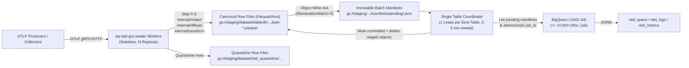

# Post-`v1` Standalone GCS Batch Row-File Loader (`bq-otel-gcs-loader`) Specification

- **Status**: Proposed Post-`v1` Architecture Specification (`ADR-20`; `NV-16` explicitly **`NOT VERIFIED`**)
- **Related Decisions**: [`docs/adr/0001-schema-v1-and-high-volume-logs.md`](../adr/0001-schema-v1-and-high-volume-logs.md) (`ADR-03`, `ADR-20`, `NV-16`), [`docs/schema-rationale.md`](../schema-rationale.md)

---

## 1. Purpose, Scope, and Partner Cost/SLO Trigger Gate

This document specifies the standalone post-`v1` `bq-otel-gcs-loader` batch writer and BigQuery `LOAD` coordinator for ultra-high-volume deployments (such as 20+ TB/day edge/access logs) that may want to trade real-time streaming latency for GCS batch loading.

### 1.1 Hard Architectural Boundaries (`ADR-20`)

1. **Separate binary, never an exporter mode**: `bigqueryexporter` preserves `"one schema, one exporter"` (`config.go:53-57`). There is **no** `write.mode: gcs_load` inside `bigqueryexporter`; batch loading lives in a standalone `bq-otel-gcs-loader` component/binary that reuses `internal/redact`, `internal/offload`, `internal/transform`, and `internal/schema`.
2. **Never a cron `bq load` wrapper over stock `googlecloudstorageexporter`**: Stock OTel `googlecloudstorageexporter` writes raw OTLP JSON/protobuf blobs that **cannot** satisfy the `BQ-OTEL-Exporter` table contract (§2).
3. **Never promise `"$0/GiB + 1–5 min SLA"`**: Shared-pool BigQuery `LOAD` has **no** throughput/latency SLA, and BigQuery caps every destination table at **1,500 load jobs/day (including failed jobs)** (§3).

### 1.2 Partner Cost & SLO Trigger Gate (When to Build vs. Not Build)

`bq-otel-gcs-loader` is **gated out of `v1.0.0`**. Before building or deploying a batch GCS loader, an operator or design partner must first apply the in-pipeline Write API cost controls:

1. Trim redundant host/Kubernetes `resource.attributes` upstream (e.g., via `resourceprocessor` / `attributesprocessor` / `transformprocessor`), which drive `31%–58%` of encoded `ProtoRows` bytes on trace-less access logs.
2. Adopt the sidecar-free `v0alpha3` / `v1.0.0` schema (`ADR-06`) and drop `record_fingerprint` (`ADR-07`).
3. Supply upstream `insert_id` attributes (`logging.googleapis.com/insertId`, `gcp.insert.id`, `gcp.insert_id`, `log.record.uid`, or `logs.insert_id_attribute`) for zero-hash fast-path ingestion, or opt out via `logs.synthesize_insert_id: false` when ID-less retry deduplication is not required.
4. Enable `sending_queue.batch`, `write.stream_pool_size: 8`, and `write.backpressure.enabled: true` (`deploy/helm/bigquery-otel-collector/values-high-volume-logs.yaml`).

**Trigger Condition**: Build `cmd/bq-otel-gcs-loader` **only** if a design partner proves with measured post-trimming byte counts that BigQuery Storage Write API ingestion (`$0.025 / GiB` after `2 TiB/month` free) remains a hard adoption blocker **and** explicitly accepts either `2–5 min` best-effort batch latency on shared slots or dedicated BigQuery `PIPELINE` slot reservations.

---

## 2. Why Stock `googlecloudstorageexporter` + Cron `bq load` Fails This Contract

Loading raw OTLP JSON written by the stock OpenTelemetry Collector `googlecloudstorageexporter` via `bq load` violates the `otel_spans`, `otel_logs`, `otel_metrics`, and `otel_quarantine` table contracts (`internal/schema/tableschema.go`) in five non-recoverable ways:

| Contract Requirement | Source Reference | Why Stock `googlecloudstorageexporter` + `bq load` Fails |
|---|---|---|
| **Flattened Typed Row Schema** | `internal/schema/tableschema.go` | Stock OTLP JSON nests `resourceLogs[].scopeLogs[].logRecords[]` (`ExportLogsServiceRequest`) with proto3 JSON camelCase keys and `AnyValue` unions (`{"stringValue": ...}`), not flat per-record rows with `TIMESTAMP` partition columns, `INT64` nanoseconds, and plain BigQuery `JSON` maps. |
| **Log Identity & `insert_id` Resolution** | `internal/transform/fingerprint.go:279-309` | Does not extract `logs.insert_id_attribute` / well-known `insert_id` keys or compute the deterministic `26 B` `"id1:"` incremental type-tagged SHA-256 content hash (`hashLogRecordDigestV1`), breaking `otel_logs_dedup` when retries occur. |
| **Intra-Batch Export Ordinals** | `internal/transform/fingerprint.go:313-339, 375-448` | Does not assign `intra_batch_ordinal` across identical records inside one batch (`fingerprinterV1.nextLogInsertID`, `nextMetricFingerprint`, `PreserveLogOrdinalPeersForContract`), silently collapsing distinct identical events on batch load. |
| **GCS Payload Offloading & `object_refs`** | `internal/offload/offload.go`, `tableschema.go:116-123` | Cannot offload oversized attributes/bodies to `object_refs` (`STRUCT<uri, version, authorizer, details>`) or enforce `limits.*` bounds with `otel_quarantine` routing. |
| **Timestamp Fallback & Step-0 Redaction** | `internal/transform/rows.go:1036-1045`, `internal/redact/` | Does not compute `timestamp_source` (`"event"` / `"observed"` / `"exporter"`), `observed_timestamp` `NULL` preservation, `service_name` / `log_name` extraction, or Step-0 secret redaction prior to hashing and storage. |

---

## 3. BigQuery `LOAD` Quotas, Shared-Pool SLO Reality & True TCO (`NV-16`)

> [!IMPORTANT]
> **`NV-16` Status (`NOT VERIFIED`)**: `1–5 min` shared-pool `LOAD` freshness, shared-pool slot capacity under contention, and end-to-end query availability at 20+ TB/day have **not** been live-measured. Do not promise `"$0/GiB + 1–5 min SLA"`.

### 3.1 Why Free Shared-Pool `LOAD` and a `1–5 min` SLA Are Mutually Exclusive

1. **Zero capacity or throughput guarantee on shared slots**: BigQuery free batch `LOAD` jobs execute on a shared, best-effort slot pool. During regional contention, load jobs can queue indefinitely before starting, making a hard `1–5 min` end-to-end freshness SLA impossible to guarantee on free shared slots.
2. **Hard 1,500 `LOAD` jobs/table/day cap (including failed jobs)**:
   - BigQuery enforces a hard quota of **`1,500` load jobs per table per day**, counting **both succeeded and failed/retried jobs**.
   - A `1 min` cron cadence consumes **`1,440` jobs/day (`96%` of the table cap)** in steady state, leaving only `60` jobs/day across all retries, backfills, and late partitions — guaranteed quota exhaustion on any transient failure or multi-collector deployment.
   - Even with `2` uncoordinated writers at a `2 min` cadence (`2 x 720 = 1,440`), the table hits the `1,500/day` wall immediately.
3. **Mandatory coordinator cadence**:
   - A production `bq-otel-gcs-loader` **must** enforce a **single coordinator per destination table** sweeping staged objects on a **`2–5 min` cadence** (`720` jobs/day at `2 min`, `288` jobs/day at `5 min`), leaving `2x–5x` headroom for retries and partition backfills within `1,500 jobs/table/day`.

### 3.2 True Cost Components Beyond BigQuery Ingestion

Although BigQuery batch `LOAD` on the shared pool carries `$0/GiB` ingestion SKU cost, it is **not free**:

| Cost Dimension | Shared-Pool Batch `LOAD` | Dedicated `PIPELINE` Slots (`LOAD` SLA) | Storage Write API (`bigqueryexporter`) |
|---|---|---|---|
| **BigQuery Ingestion SKU** | `$0.00 / GiB` (best-effort shared pool) | `$0.00 / GiB` + dedicated reservation cost | `$0.025 / GiB` after `2 TiB/mo` free |
| **GCS Staging Storage** | `$0.020–$0.026 / GiB-mo` for staged row files during `2–5 min` + cleanup window | Same | `$0.00` (streams directly to BigQuery) |
| **GCS Class A/B Operations** | `$5.00–$10.00 / 1M` object `PUT`s + `LIST`/cleanup ops (coalesce batches to `>= 64–256 MiB` objects to bound ops!) | Same | `$0.00` (unless `offload.enabled: true`) |
| **Transform / Coordinator Compute** | `bq-otel-gcs-loader` row-file writers + Parquet/Avro encoding + single-coordinator loop | Same | Collector pods (`memory_limiter`, `batch`, `bigqueryexporter`) |
| **BigQuery `PIPELINE` Slots** | `$0` (no freshness SLA; `NV-16` unverified) | BigQuery Standard/Enterprise `PIPELINE` slot commitment (`$0.04–$0.06 / slot-hr` PAYG) | Not required |
| **End-to-End Freshness** | Unbounded under contention (`>= 2–5 min` best effort) | Bounded by `2–5 min` coordinator interval + `PIPELINE` slot capacity | Sub-second to `~5s` (`batch.timeout`) |

---

## 4. `bq-otel-gcs-loader` Target Architecture



### 4.1 Reuse of `internal/transform` & Contract Parity

Every `bq-otel-gcs-loader` worker processes incoming OTLP batches through the exact shared library pipeline used by `bigqueryexporter`:

1. **Step 0 (`internal/redact`)**: Mask blocked keys and value patterns before any offloading or hashing.
2. **Step 1 (`internal/offload`)**: Upload oversized attributes/bodies above `offload.min_bytes` to the permanent `object_refs` bucket (`ifGenerationMatch=0`), returning 4-field `ObjectRef` structs (`uri`, `version`, `authorizer`, `details` containing only `gcs_metadata`).
3. **Step 2 (`internal/transform`)**: Transform `ptrace.Traces`, `plog.Logs`, and `pmetric.Metrics` using `ContractV1Candidate` / `v1.0.0` (`SpansForContract`, `LogsForContract`, `MetricsForContract`), computing deterministic `insert_id` (`logs.synthesize_insert_id`, `intra_batch_ordinal`) and `point_fingerprint` (`Metrics`). Records violating `limits.*` route to `schema.QuarantineTableSchema()` (`otel_quarantine`).
4. **Step 3 (Canonical Row-File Serialization)**: Serialize transformed `transform.Row` records into **Apache Parquet** (recommended; Zstd-compressed, strongly typed, compact GCS staging) or **Apache Avro** matching `internal/schema/tableschema.go` column-for-column (`TIMESTAMP`, `INT64`, `FLOAT64`, `BOOL`, `STRING`, `JSON`, nested `STRUCT`, and `ARRAY` modes, with `otel_schema_{major,minor,patch,variant}` verified at startup).

### 4.2 GCS Layout & Immutable Object Manifests

Workers buffer rows in memory up to a target file size (e.g., `64–256 MiB` uncompressed or `30–60s` max age to keep GCS Class A ops small) and write immutable row files + manifests using `ifGenerationMatch=0`:

- **Row file path**:
  `gs://<staging-bucket>/<prefix>/<project>/<dataset>/<table>/dt=<YYYY-MM-DD>/hr=<HH>/worker=<pod>-<ulid>.parquet`
- **Manifest path**:
  `gs://<staging-bucket>/<prefix>/<project>/<dataset>/<table>/manifests/pending/<ts_millis>-<ulid>.json`

Each manifest JSON records:

```json
{
  "manifest_version": 1,
  "destination": "my-project.otel.otel_logs",
  "schema_contract": { "major": "0", "minor": "3", "patch": "0", "variant": "default" },
  "created_at": "2026-11-13T09:00:00Z",
  "format": "PARQUET",
  "row_count": 250000,
  "row_bytes": 187500000,
  "objects": [
    { "uri": "gs://.../worker-a-01J...parquet", "crc32c": "...", "bytes": 41200310, "rows": 250000 }
  ]
}
```

### 4.3 Single Coordinator Per Table & Deterministic `job_id`

1. **Leader Election (1 Coordinator per `project.dataset.table`)**:
   - Each destination table (`otel_spans`, `otel_logs`, `otel_metrics`, `otel_quarantine`) acquires a single active lease (Kubernetes `Lease`, Cloud Spanner lock, or GCS conditional-generation lock object) so concurrent replicas never race against BigQuery's `1,500 jobs/table/day` cap.
2. **Sweep Window (`2–5 min` Cadence)**:
   - On each tick (`interval >= 2m`, recommended `3m–5m` = `288–480 jobs/day`), the coordinator collects up to `10,000` pending row-file URIs (sorted lexicographically by manifest/URI) into a single BigQuery `LOAD` configuration with `write_disposition = WRITE_APPEND`, `create_disposition = CREATE_NEVER` (or pre-validated schema).
   - **Time-partitioning note**: Row files carrying rows across multiple `DATE(timestamp)` / `TIMESTAMP_TRUNC(start_time, HOUR)` partitions load into the partitioned destination table in a single `LOAD` job without `$YYYYMMDD` decorator splitting, avoiding multiplying job counts by partition count.
3. **Deterministic `job_id` & Idempotent Retries**:
   - Compute `job_id = "bqload_" + hex(sha256(destination + "\n" + joined_sorted_manifest_ids)[:16])` (valid `[A-Za-z0-9_-]{1,1024}` BigQuery job ID).
   - If the coordinator crashes or restarts after calling `jobs.insert` and re-submits the exact manifest set, BigQuery returns `409 Already Exists`; the coordinator calls `jobs.get(job_id)` and polls the in-flight job to completion without consuming an extra quota slot.

### 4.4 Ack Boundary, Restart Recovery, Quarantine & GCS Cleanup

1. **Ack Boundary (Two-Stage Durability)**:
   - **Ingest Ack**: `bq-otel-gcs-loader` workers return `OTLP ExportResponse` success **only** after both the Parquet/Avro row file and its pending manifest object are durably committed to GCS (`ifGenerationMatch=0`).
   - **Warehouse Commit**: The coordinator moves the manifest from `manifests/pending/` to `manifests/committed/` **only** after BigQuery `jobs.get(job_id)` reports `status.state == "DONE"` with `status.errorResult == nil`.
   - **Duplicate Bound**: Because `internal/transform` computed deterministic `insert_id` / `point_fingerprint` + `intra_batch_ordinal` before writing the row file, re-exporting an unacked OTLP batch or replaying a row file preserves identical dedup keys for `otel_spans_dedup`, `otel_logs_dedup`, and `otel_metrics_dedup`.
2. **Restart Recovery**:
   - **Worker crash**: Uncommitted local buffers are not acked to upstream Collectors (`sending_queue` replays the OTLP batch). Orphaned `.parquet` objects without a manifest are ignored by the coordinator and reaped by bucket TTL.
   - **Coordinator crash**: On lease acquisition, the new coordinator reads any `manifests/inflight/` lock marker, checks `jobs.get(job_id)` for its deterministic `job_id`, finishes polling if `RUNNING` or already `DONE`, and only then starts the next `2–5 min` sweep.
3. **Quarantine Handling**:
   - **Transform-time rejections** (`limits.*`, overflow timestamps): Routed during Step 2 to a separate `otel_quarantine` staging prefix and loaded via the same `bq-otel-gcs-loader` coordinator (or written directly via Storage Write API if quarantine volume is low).
   - **Load-time failures** (`invalid` Parquet/schema mismatch or row error): The coordinator **never** drops or loops infinitely on a poison manifest. Failed manifests are moved to `manifests/quarantined/<job_id>.json` with `status.errors` attached and an alert metric emitted for operator inspection.
4. **GCS Cleanup (Two-Layer)**:
   - **Active coordinator delete**: Once `manifests/committed/<id>.json` is recorded, the coordinator deletes the source `.parquet` staging objects (and archives/deletes the committed manifest) asynchronously in bounded batches.
   - **Bucket Lifecycle Rule (mandatory safety net)**: Configure a GCS Object Lifecycle policy on the staging bucket/prefix (`Delete` after `7`–`14` days) so unreferenced orphaned files from crashed workers or quarantined windows cannot accumulate storage cost indefinitely.
